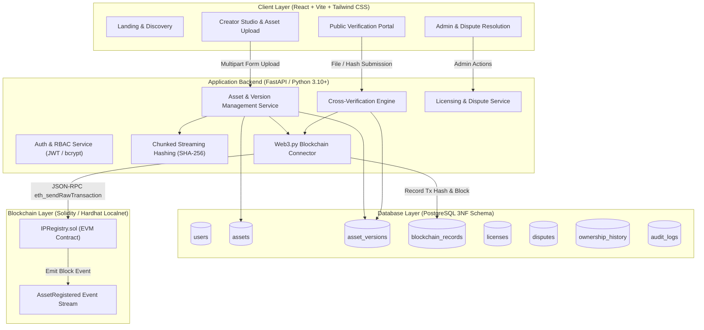
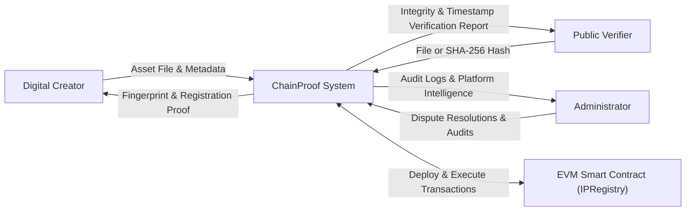
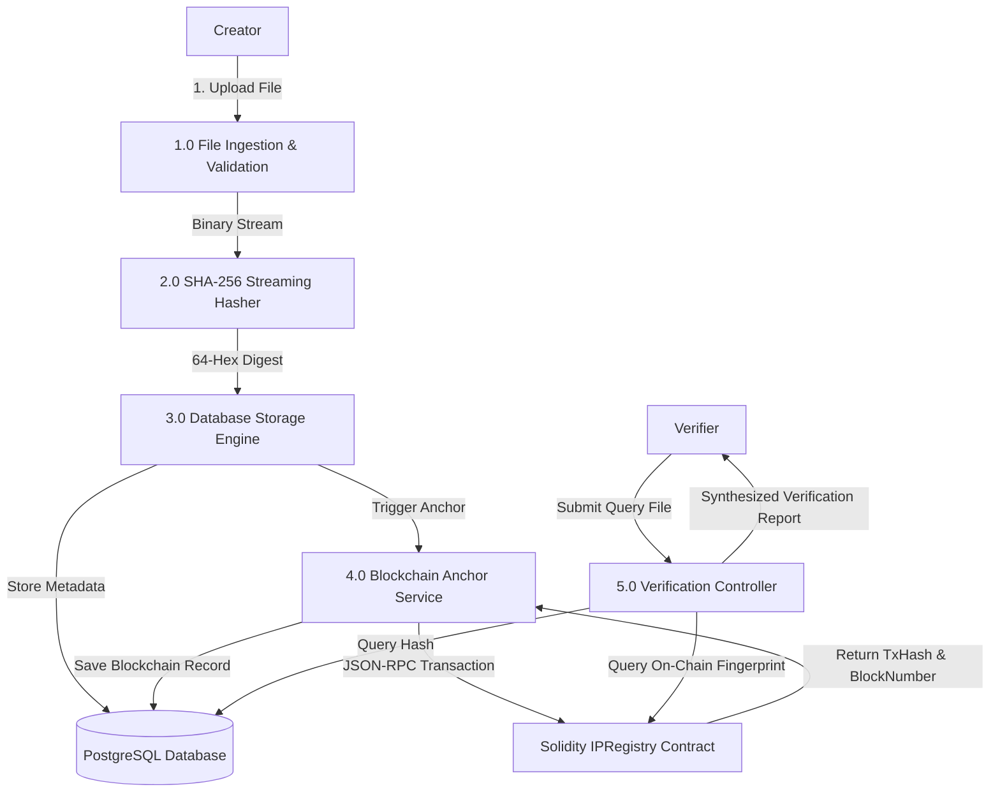
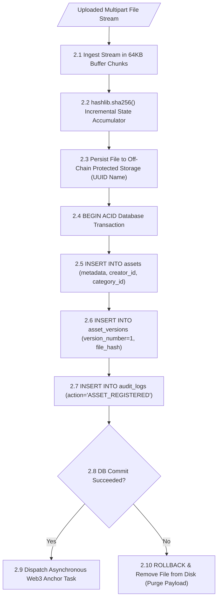
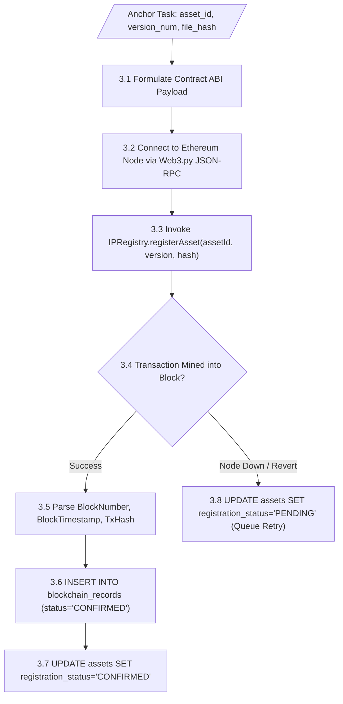
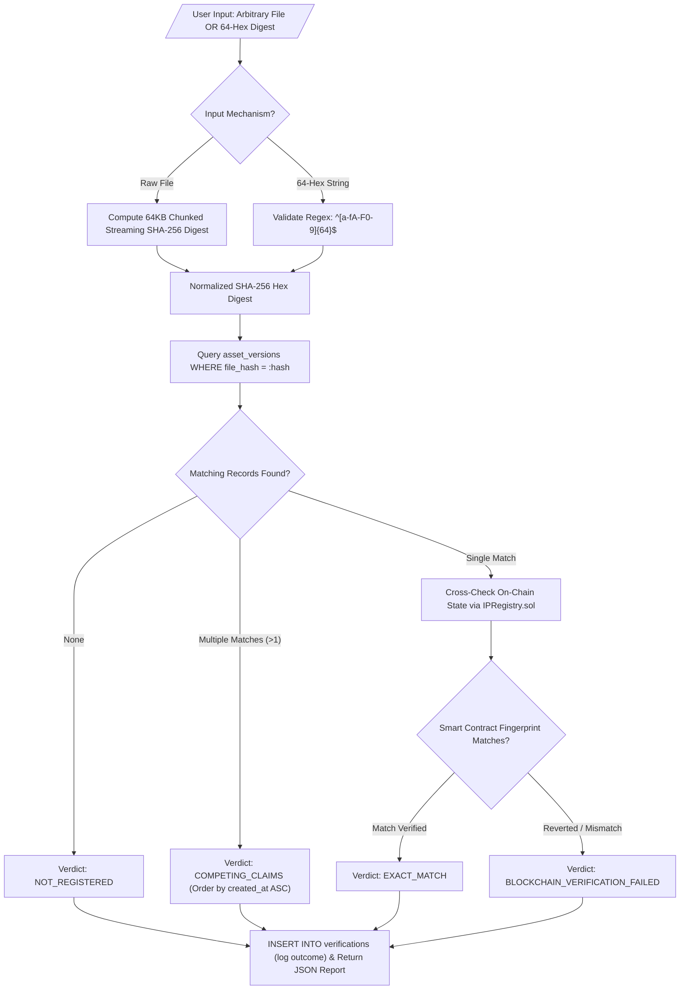
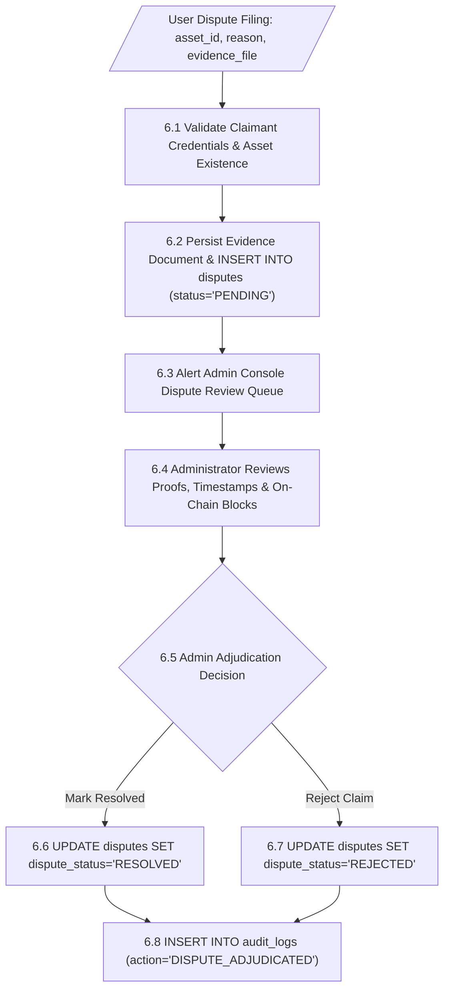
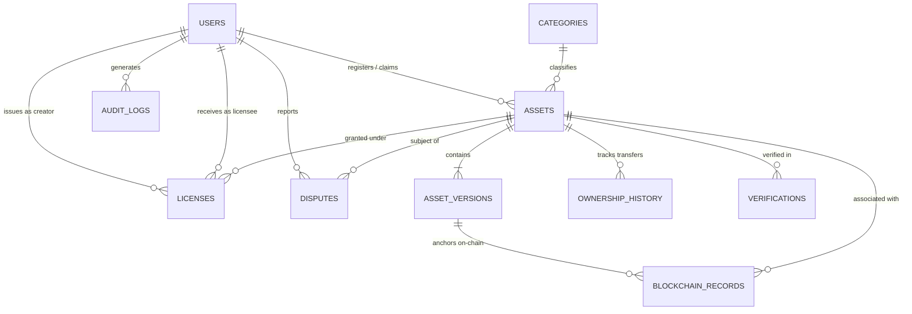

# ChainProof: Blockchain-Based Digital Intellectual Property Registration and Verification System
## Comprehensive Academic Project Report & System Dossier

---

### Abstract

Digital creators face significant challenges in asserting ownership, establishing chronological precedence, and proving file integrity in decentralized and digital-first environments. Traditional copyright systems are slow, centralized, geographically fragmented, and often cost-prohibitive for independent creators. Conversely, naïve blockchain claims often conflate timestamped cryptographic existence with legal copyright ownership. 

**ChainProof** is a hybrid intellectual property management platform developed to bridge this gap. ChainProof integrates a normalized, third-normal-form (3NF) PostgreSQL relational database with a Solidity smart contract deployed on an Ethereum-compatible network. It leverages deterministic, chunked SHA-256 fingerprinting to anchor immutable, tamper-proof proof-of-existence records on-chain, while preserving complex metadata, licensing terms, version progression trees, ownership claims, and dispute workflows in a high-performance relational database. Crucially, the system formalizes the critical distinction between cryptographic file integrity verification and legally recognized copyright ownership.

---

### 1. Introduction

Intellectual Property (IP) in the digital era encompasses software source code, digital artworks, research literature, and multimedia compositions. The digital medium presents a dual dilemma: files can be copied bit-for-bit without quality degradation, and creation timestamps stored in local operating systems or centralized cloud servers can easily be altered, backdated, or fabricated.

ChainProof provides an enterprise-grade academic solution combining:
1. **Relational Database Management System (PostgreSQL)**: Serves as the primary source of truth for structured application state, user identities, role-based authorization, licensing permissions, dispute evidence, and analytical indexing.
2. **Blockchain Layer (Solidity / Hardhat)**: Serves as an immutable timestamped witness, immutably anchoring the cryptographic SHA-256 fingerprint alongside the block number and block timestamp.
3. **Decoupled Application Architecture (FastAPI + React)**: Delivers a clean separation of concerns, ensuring high throughput, deterministic hashing, and an accessible user experience.

---

### 2. Problem Statement

Existing digital intellectual property mechanisms exhibit four fundamental deficiencies:
1. **Timestamp Vulnerability**: Centralized database timestamps can be manipulated by server administrators or compromised by malicious actors.
2. **Legal and Cryptographic Conflation**: Platforms erroneously market blockchain tokens (such as NFTs) as legal copyright titles, leading to copyright infringement and confusion over what is cryptographically verified versus legally established.
3. **Absence of Provenance & Version Lifecycle**: Software and creative assets evolve through multiple iterations; existing registries lack immutable versioning linked to distinct cryptographic fingerprints.
4. **Fragile Verification Mechanisms**: Verifiers lack transparent, public mechanisms to upload files and mathematically verify integrity without subscription gates or custodial risk.

---

### 3. Project Objectives

ChainProof was engineered to fulfill the following measurable objectives:
1. **Cryptographic Fingerprinting**: Generate deterministic, streaming SHA-256 digests for images, documents, and source code files up to 25MB.
2. **Immutable Blockchain Anchoring**: Deploy an audited Solidity smart contract (`IPRegistry.sol`) on an Ethereum development network to permanently anchor asset fingerprints.
3. **Multi-Version Tree Management**: Allow creators to release incremental asset versions (v1, v2, v3), each carrying its own independent on-chain fingerprint while preserving ancestral history.
4. **Public Dual-Mode Verification**: Enable anyone to upload an arbitrary file or submit a 64-hex SHA-256 string to inspect matching status, on-chain confirmation, and competing claims.
5. **Competing Claim Preservation**: When multiple creators submit identical files, preserve both claims with distinct timestamps rather than discarding subsequent filings, providing objective chronological precedence.
6. **Licensing Framework**: Implement Personal, Educational, Commercial, and Custom licensing grants with automated expiry tracking and revocation capabilities.
7. **Dispute Resolution Infrastructure**: Provide structured dispute filings with evidence attachments and administrative resolution queues.
8. **Academic Relational Architecture**: Enforce 3NF database normalization, ACID transactional integrity, views, triggers, and stored procedures.

---

### 4. Existing System vs. Proposed System

| Dimension | Existing Systems (Traditional Copyright / NFT Registries) | Proposed System (ChainProof) |
|---|---|---|
| **Timestamp Trust Model** | Centralized server timestamps or manual government notarization | Decentralized Ethereum block timestamp verified by smart contract consensus |
| **File Storage Cost** | Centralized cloud buckets; NFT platforms store large data on-chain or fragile IPFS gateways | Hybrid: Raw files stored locally/cloud; only 32-byte cryptographic fingerprints anchored on-chain |
| **Integrity Verification** | Proprietary internal algorithms | Open SHA-256 chunked streaming verification matching smart contract state |
| **Version History** | Overwrites prior files or lacks linkage | Immutable version tree (`asset_versions`) with individual on-chain proofs |
| **Competing Claims** | Rejects or silently discards duplicate submissions | Preserves all claims chronologically with explicit competing claim flags |
| **Legal Clarity** | Conflates token possession with copyright title | Explicit legal distinction: cryptographic proof of existence $\neq$ copyright ownership |

---

### 5. Requirements Specification

#### 5.1 Functional Requirements
- **FR-01 Authentication & RBAC**: Secure registration, login (JWT HS256, bcrypt password hashing), and role gating across `CREATOR`, `VERIFIER`, and `ADMINISTRATOR`.
- **FR-02 Asset Registration**: Upload digital assets, compute chunked SHA-256 digests, and store metadata in PostgreSQL.
- **FR-03 Smart Contract Anchoring**: Transmit Web3 transactions to `IPRegistry.sol`, storing `transaction_hash`, `block_number`, and `blockchain_timestamp`.
- **FR-04 File Verification**: Compute uploaded file hash, search PostgreSQL, verify on-chain fingerprint, and classify result into `EXACT_MATCH`, `NOT_REGISTERED`, or `BLOCKCHAIN_VERIFICATION_FAILED`.
- **FR-05 Version Management**: Upload incremental releases with automatic version incrementation and separate on-chain anchoring.
- **FR-06 Licensing**: Issue Personal, Educational, Commercial, and Custom licenses with status tracking (`ACTIVE`, `EXPIRED`, `REVOKED`).
- **FR-07 Ownership Claims**: Transfer registered claims, capturing new claimant IDs, contract references, and reasons in immutable historical logs.
- **FR-08 Disputes & Administration**: File disputes with evidence; allow admins to review queues, resolve claims, and audit platform activity.

#### 5.2 Non-Functional Requirements
- **NFR-01 Deterministic Performance**: SHA-256 generation processes files in 64KB chunks to maintain $O(1)$ memory overhead regardless of file size.
- **NFR-02 ACID Relational Integrity**: Enforced via foreign key constraints (`ON DELETE RESTRICT` / `ON DELETE SET NULL`), check constraints, and atomic transactions.
- **NFR-03 Blockchain Idempotency**: Smart contract and backend service enforce duplicate prevention on identical asset versions (`assetId + versionNumber`).
- **NFR-04 Network Resiliency**: When blockchain node is offline, backend safely flags status as `PENDING` and supports automated/manual retries without duplicate DB insertions.

---

### 6. System Architecture



---

### 7. Data Flow Diagrams (DFD)

#### 7.1 DFD Level 0 (Context Diagram)


#### 7.2 DFD Level 1 (Decomposition)


#### 7.3 DFD Level 2 (Functional Decomposition)

##### 7.3.1 DFD Level 2: Asset Ingestion & Streaming SHA-256 Hashing (Process 2.0)


##### 7.3.2 DFD Level 2: Blockchain Anchoring & Transaction Receipt Pipeline (Process 3.0 / 4.0)


##### 7.3.3 DFD Level 2: Dual-Mode Public Verification & Competing Claims Engine (Process 5.0)


##### 7.3.4 DFD Level 2: Dispute Adjudication & Audit Resolution Lifecycle (Process 6.0)


---

### 8. Entity-Relationship (ER) Modeling & Relational Schema



#### Relational Schema (3NF Notation)
1. **`users`** ($\underline{\text{user\_id}}$, full\_name, email, password\_hash, role, account\_status, created\_at)
2. **`categories`** ($\underline{\text{category\_id}}$, category\_name, description, created\_at)
3. **`assets`** ($\underline{\text{asset\_id}}$, $\text{creator\_id}^*$, $\text{category\_id}^*$, title, description, original\_filename, stored\_filename, file\_path, file\_size, mime\_type, visibility, registration\_status, created\_at, registered\_at)
4. **`asset_versions`** ($\underline{\text{version\_id}}$, $\text{asset\_id}^*$, version\_number, file\_hash, hash\_algorithm, file\_path, changelog, created\_at)
   - *Candidate Key*: (`asset_id`, `version_number`)
5. **`blockchain_records`** ($\underline{\text{record\_id}}$, $\text{asset\_id}^*$, $\text{version\_id}^*$, transaction\_hash, block\_number, network\_name, contract\_address, blockchain\_timestamp, transaction\_status, created\_at)
   - *Candidate Key*: `transaction_hash`
6. **`licenses`** ($\underline{\text{license\_id}}$, $\text{asset\_id}^*$, $\text{creator\_id}^*$, $\text{licensee\_id}^*$, license\_type, description, start\_date, expiry\_date, status, created\_at)
7. **`verifications`** ($\underline{\text{verification\_id}}$, $\text{verifier\_id}^*$, $\text{asset\_id}^*$, submitted\_hash, verification\_result, verified\_at)
8. **`disputes`** ($\underline{\text{dispute\_id}}$, $\text{asset\_id}^*$, $\text{reporter\_id}^*$, description, evidence\_path, dispute\_status, resolution\_notes, resolved\_by, created\_at, resolved\_at)
9. **`ownership_history`** ($\underline{\text{history\_id}}$, $\text{asset\_id}^*$, $\text{previous\_owner\_id}^*$, $\text{new\_owner\_id}^*$, transaction\_reference, changed\_at)
10. **`audit_logs`** ($\underline{\text{log\_id}}$, $\text{user\_id}^*$, action, entity\_type, entity\_id, details, created\_at)

---

### 9. Database Normalization Analysis

- **First Normal Form (1NF)**: Every attribute contains only atomic, indivisible values. No repeating groups or array attributes exist within tuples. Every table defines an explicit primary key.
- **Second Normal Form (2NF)**: The schema satisfies 1NF, and every non-key attribute is fully functionally dependent on the entire primary key. In tables with composite candidate keys such as `asset_versions` (`asset_id`, `version_number`), attributes such as `file_hash` and `created_at` depend on the full composite key, eliminating partial dependencies.
- **Third Normal Form (3NF)**: The schema satisfies 2NF, and no transitive functional dependencies ($X \to Y$ and $Y \to Z$ where $Z$ is a non-prime attribute) exist. Creator names and category names are not stored in the `assets` table; they are maintained in `users` and `categories` and retrieved via relational foreign-key joins.

---

### 10. Technology Stack Justification

- **PostgreSQL**: Industry standard relational engine providing ACID compliance, native JSON querying, robust constraint triggers, and write-ahead logging (WAL).
- **FastAPI (Python 3.10+)**: High-performance asynchronous ASGI framework with automated OpenAPI 3.0 schema generation and Pydantic v2 data validation.
- **Solidity (^0.8.20)**: Statically typed contract programming language running on the Ethereum Virtual Machine (EVM) with built-in overflow protection and structured custom errors.
- **Web3.py**: Production-tested Python EVM bridge managing transaction signing, nonce tracking, gas estimation, and ABI parsing.
- **React + Vite + Tailwind CSS**: Modern modular component frontend ensuring rapid sub-second HMR development, typed contracts with TypeScript, and responsive styling.

---

### 11. Smart Contract Architecture (`IPRegistry.sol`)

The `IPRegistry` smart contract provides:
1. **Storage Mapping**:
   ```solidity
   mapping(string => mapping(uint256 => AssetRecord)) private registry;
   ```
   Stores cryptographic records indexed by `keccak256(assetId)` and `versionNumber`.
2. **Deterministic Fingerprint Anchoring**:
   - Accepts 64-character hexadecimal SHA-256 string.
   - Rejects duplicate registration attempts for the same `assetId + versionNumber`.
   - Records `block.number`, `block.timestamp`, and caller `msg.sender`.
   - Emits `AssetRegistered` indexed event.
3. **Competing Claim Support**:
   - If creator $B$ registers asset $A_2$ carrying the identical SHA-256 fingerprint previously registered by creator $A$ for asset $A_1$, the contract successfully accepts $A_2$.
   - Both events and timestamps exist permanently on-chain, enabling verification callers to evaluate prior registration objectively.
4. **Public Read-Only Verification**:
   - `verifyFingerprint(assetId, versionNumber, expectedFingerprint)` performs zero-gas view verification comparing the submitted hash against storage.

---

### 12. Testing Methodology & Verification Results

#### 12.1 Smart Contract Unit Tests (Hardhat)
All 11 unit tests passed successfully:
```
  IPRegistry Smart Contract
    Deployment
      √ should initialize with zero total registrations
    Asset Fingerprint Registration
      √ should successfully register an asset fingerprint and emit AssetRegistered event
      √ should reject duplicate registration of the same asset version identifier
      √ should support multiple incremental versions of the same asset
      √ should allow different creators to register independent claims on identical fingerprints
    Fingerprint Verification
      √ should confirm an exact fingerprint match
      √ should flag a fingerprint mismatch when file is altered
      √ should report non-registration for unknown asset versions
    Input Validation
      √ should reject empty asset ID
      √ should reject zero version number
      √ should reject invalid fingerprint length

  11 passing (770ms)
```

#### 12.2 Backend & System Integration Tests (Pytest)
All 39 automated integration tests passed successfully:
```
backend/tests/test_assets.py .......                                     [ 17%]
backend/tests/test_auth.py ......                                        [ 33%]
backend/tests/test_blockchain.py .......                                 [ 51%]
backend/tests/test_disputes.py .                                         [ 53%]
backend/tests/test_file_validation.py ....                               [ 64%]
backend/tests/test_hashing.py ...                                        [ 71%]
backend/tests/test_licensing.py ..                                       [ 76%]
backend/tests/test_ownership_and_analytics.py ...                        [ 84%]
backend/tests/test_verification.py ....                                  [ 94%]
backend/tests/test_versions.py ..                                        [100%]

======================= 39 passed in 103.34s =======================
```

---

### 13. System Security & Reliability Assessment

1. **Authentication & Password Security**: Passwords hashed using standard `bcrypt` with salt rounds. Session tokens are signed using HS256 JWT with configurable 24-hour expiration.
2. **Path Traversal & Injection Prevention**: Uploaded filenames are sanitized into UUID-derived storage names (`uuid4().hex + ext`), preventing path traversal attacks. All SQL queries use SQLAlchemy parameterized expressions, immune to SQL injection.
3. **Blockchain Key Isolation**: Private keys are isolated in server environment variables (`DEPLOYER_PRIVATE_KEY`) and never transmitted to the browser client.
4. **Offline Node Resilience**: If the Hardhat node becomes temporarily unreachable, asset registration persists safely in PostgreSQL with `PENDING` status. The UI and backend provide idempotent retry endpoints (`POST /blockchain/retry/{asset_id}`).
5. **Audit Log Immutability**: The `audit_logs` table has no DELETE or UPDATE API endpoints, ensuring an immutable chronological audit trail.

---

### 14. Academic Delimitations & Legal Boundaries

> **Fundamental Legal Principle**:  
> Blockchain registration provides objective cryptographic proof that a specific digital bitstream existed in the possession of an account holder at an immutable timestamp.  
> **It does not independently establish copyright ownership, patent validity, original authorship, or moral rights.** Legal ownership requires independent evaluation of original expression, contractual assignment, and statutory compliance under applicable national copyright statutes (e.g., US Copyright Act, Berne Convention).

---

### 15. Future Enhancements

1. **Decentralized Layer 2 Deployment**: Porting contract deployment from local Hardhat to Ethereum L2s (Arbitrum, Optimism, or Polygon) for sub-cent gas fees and mainnet finality.
2. **Zero-Knowledge Proofs (ZKP)**: Allowing creators to prove possession of an intellectual asset without revealing the raw file contents or full plaintext code.
3. **Decentralized Identity (DID)**: Integrating W3C Verifiable Credentials and ENS domains for decentralized creator reputation.
4. **Automated Licensing Micro-Payments**: Integrating smart contract escrow to automatically disburse royalty payments upon verification or license issuance.

---

### 16. Academic References

1. Nakamoto, S. (2008). *Bitcoin: A Peer-to-Peer Electronic Cash System*.
2. Wood, G. (2014). *Ethereum: A Secure Decentralised Generalised Transaction Ledger*. Ethereum Project Yellow Paper.
3. Elmasri, R., & Navathe, S. B. (2015). *Fundamentals of Database Systems* (7th ed.). Pearson.
4. Codd, E. F. (1970). *A Relational Model of Data for Large Shared Data Banks*. Communications of the ACM, 13(6), 377–387.
5. National Institute of Standards and Technology (NIST). (2015). *Secure Hash Standard (SHS)*. FIPS PUB 180-4.
6. World Intellectual Property Organization (WIPO). (2020). *WIPO Technology Trends: Blockchain in IP*.
