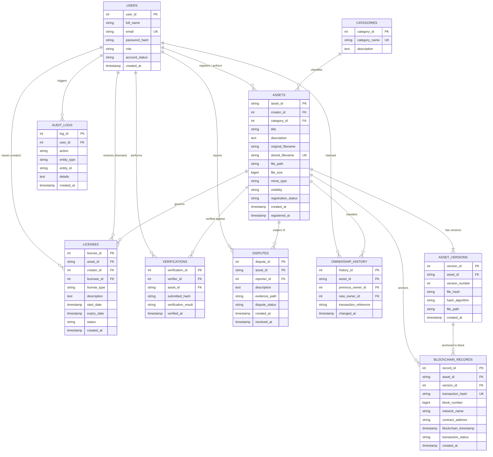
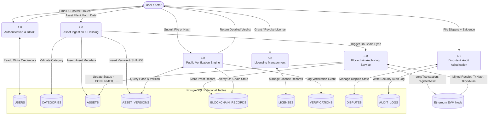
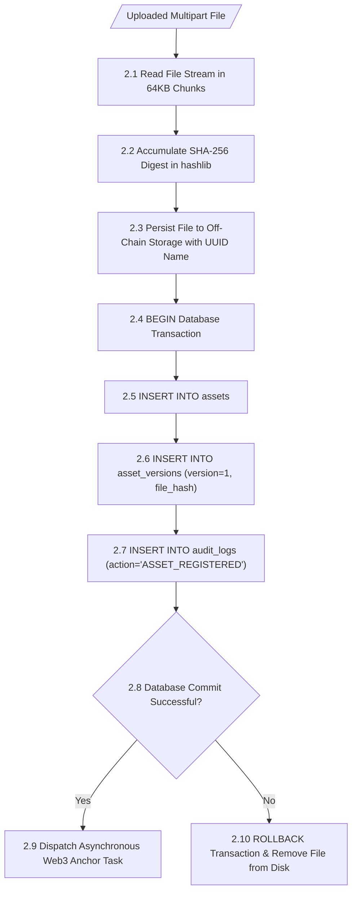
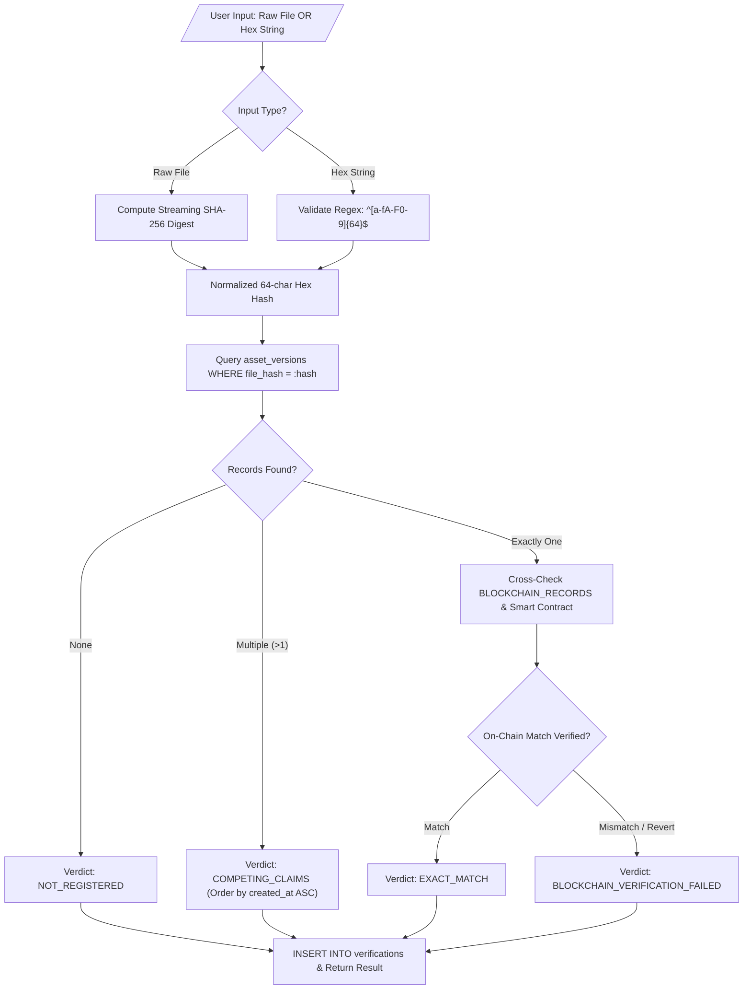
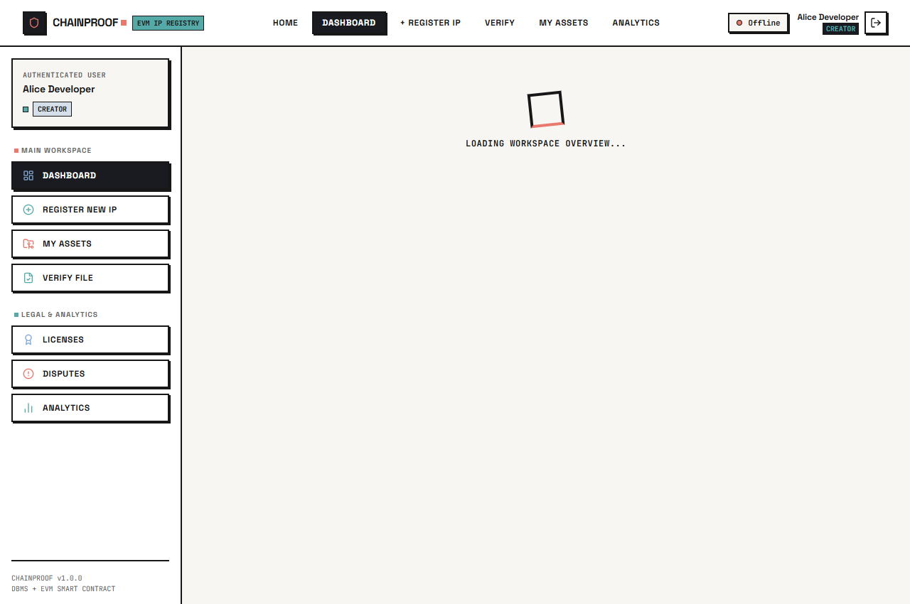
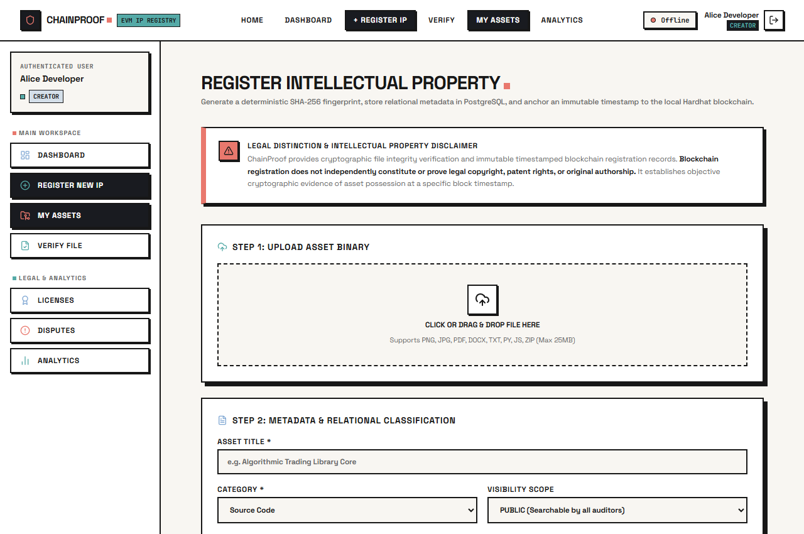
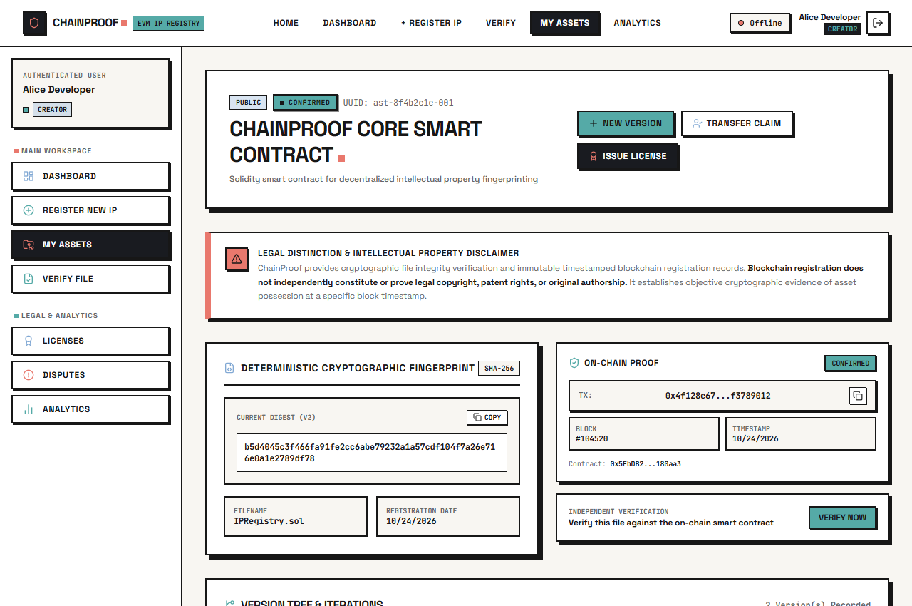
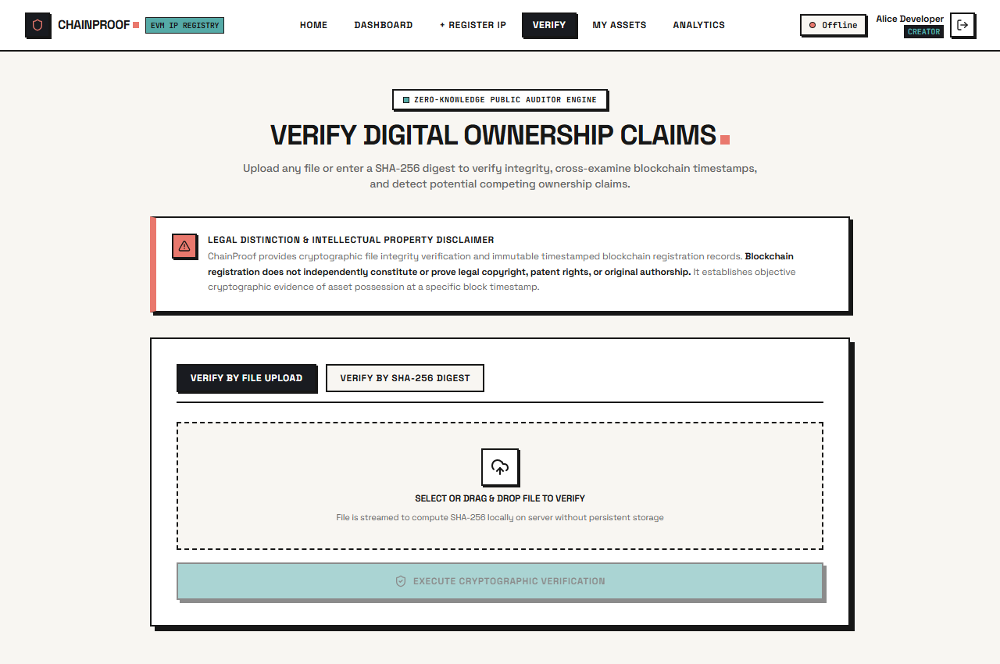
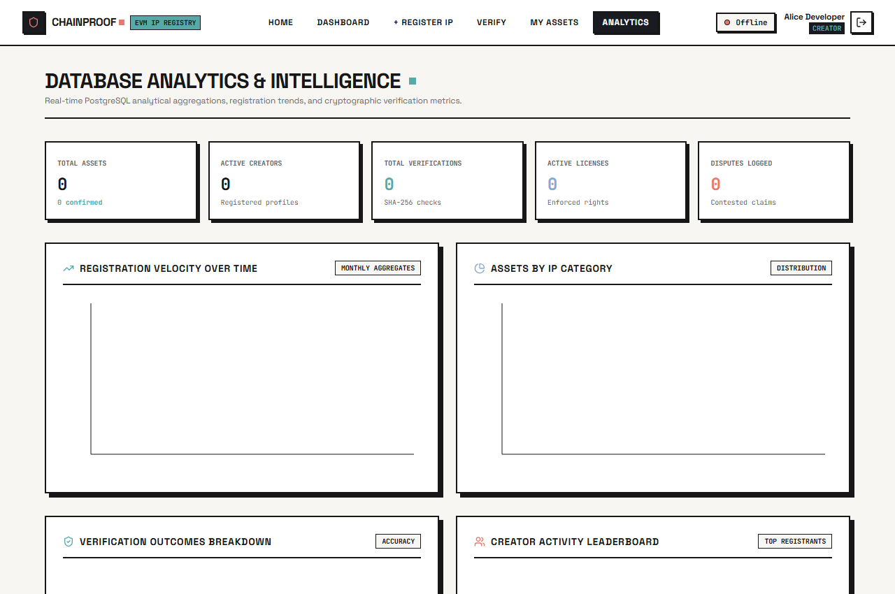
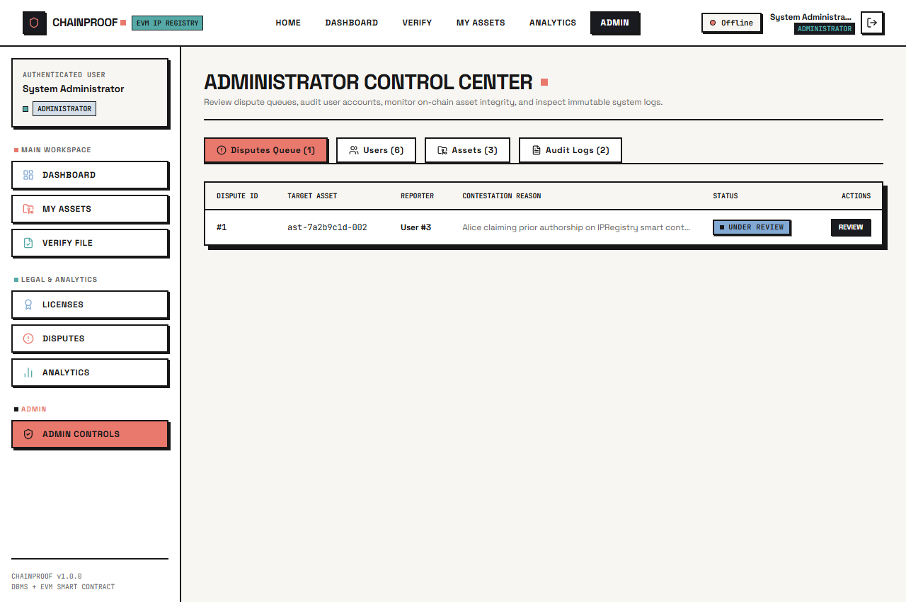

# RV COLLEGE OF ENGINEERING®
### BENGALURU – 560059
**(Autonomous Institution Affiliated to VTU, Belagavi)**
### DEPARTMENT OF COMPUTER SCIENCE AND ENGINEERING

---

# ChainProof: Blockchain-Based Digital Intellectual Property Registration and Verification System

### Mini - Project Report
Submitted in partial fulfillment for the requirement of 5th Semester  
**DATABASE MANAGEMENT SYSTEMS (CD252IA)**  
Laboratory Mini-Project  
**Academic Year 2025 – 2026**

---

### Submitted by:
| Name | USN |
| :--- | :--- |
| **Student 1** | **1RV23CS001** |
| **Student 2** | **1RV23CS002** |
| **Student 3** | **1RV23CS003** |

---

### Under the Guidance of:
**Dr. Sneha M**  
Associate Professor  
Department of Computer Science and Engineering  
R.V. College of Engineering, Bengaluru – 560059  

---

<div style="page-break-after: always;"></div>

# RV COLLEGE OF ENGINEERING®
### BENGALURU – 560059
**(Autonomous Institution Affiliated to VTU, Belagavi)**
### DEPARTMENT OF COMPUTER SCIENCE AND ENGINEERING

---

## CERTIFICATE

Certified that the project work titled **‘ChainProof: Blockchain-Based Digital Intellectual Property Registration and Verification System’** is carried out by bonafide students of R. V. College of Engineering, Bengaluru, in partial fulfillment of the curriculum requirement of **5th Semester Database Management Systems (CD252IA) Laboratory Mini Project** during the academic year **2025–2026**. 

It is certified that all corrections/suggestions indicated for the Internal Assessment have been incorporated into this report. The report has been approved as it satisfies the academic requirements in all respects for the laboratory mini-project work prescribed by the institution.

<br><br>

---------------------------------------------------- &nbsp;&nbsp;&nbsp;&nbsp;&nbsp;&nbsp;&nbsp;&nbsp;&nbsp;&nbsp;&nbsp;&nbsp;&nbsp;&nbsp;&nbsp;&nbsp;&nbsp;&nbsp;&nbsp;&nbsp;&nbsp;&nbsp;&nbsp;&nbsp;&nbsp;&nbsp;&nbsp;&nbsp; ----------------------------------------------------  
**Signature of Faculty In-charge** &nbsp;&nbsp;&nbsp;&nbsp;&nbsp;&nbsp;&nbsp;&nbsp;&nbsp;&nbsp;&nbsp;&nbsp;&nbsp;&nbsp;&nbsp;&nbsp;&nbsp;&nbsp;&nbsp;&nbsp;&nbsp;&nbsp;&nbsp;&nbsp;&nbsp;&nbsp;&nbsp;&nbsp;&nbsp;&nbsp;&nbsp;&nbsp;&nbsp;&nbsp;&nbsp;&nbsp;&nbsp;&nbsp;&nbsp;&nbsp;&nbsp;&nbsp;&nbsp;&nbsp; **Head of the Department**  
**Dr. Sneha M** &nbsp;&nbsp;&nbsp;&nbsp;&nbsp;&nbsp;&nbsp;&nbsp;&nbsp;&nbsp;&nbsp;&nbsp;&nbsp;&nbsp;&nbsp;&nbsp;&nbsp;&nbsp;&nbsp;&nbsp;&nbsp;&nbsp;&nbsp;&nbsp;&nbsp;&nbsp;&nbsp;&nbsp;&nbsp;&nbsp;&nbsp;&nbsp;&nbsp;&nbsp;&nbsp;&nbsp;&nbsp;&nbsp;&nbsp;&nbsp;&nbsp;&nbsp;&nbsp;&nbsp;&nbsp;&nbsp;&nbsp;&nbsp;&nbsp;&nbsp;&nbsp;&nbsp;&nbsp;&nbsp;&nbsp;&nbsp;&nbsp;&nbsp;&nbsp;&nbsp;&nbsp;&nbsp;&nbsp;&nbsp;&nbsp;&nbsp;&nbsp;&nbsp;&nbsp;&nbsp;&nbsp;&nbsp; **Dr. Shanta Rangaswamy**  
Associate Professor &nbsp;&nbsp;&nbsp;&nbsp;&nbsp;&nbsp;&nbsp;&nbsp;&nbsp;&nbsp;&nbsp;&nbsp;&nbsp;&nbsp;&nbsp;&nbsp;&nbsp;&nbsp;&nbsp;&nbsp;&nbsp;&nbsp;&nbsp;&nbsp;&nbsp;&nbsp;&nbsp;&nbsp;&nbsp;&nbsp;&nbsp;&nbsp;&nbsp;&nbsp;&nbsp;&nbsp;&nbsp;&nbsp;&nbsp;&nbsp;&nbsp;&nbsp;&nbsp;&nbsp;&nbsp;&nbsp;&nbsp;&nbsp;&nbsp;&nbsp;&nbsp;&nbsp;&nbsp;&nbsp;&nbsp;&nbsp;&nbsp;&nbsp;&nbsp;&nbsp;&nbsp; Professor & Head, Dept. of CSE  
Dept. of CSE, RVCE &nbsp;&nbsp;&nbsp;&nbsp;&nbsp;&nbsp;&nbsp;&nbsp;&nbsp;&nbsp;&nbsp;&nbsp;&nbsp;&nbsp;&nbsp;&nbsp;&nbsp;&nbsp;&nbsp;&nbsp;&nbsp;&nbsp;&nbsp;&nbsp;&nbsp;&nbsp;&nbsp;&nbsp;&nbsp;&nbsp;&nbsp;&nbsp;&nbsp;&nbsp;&nbsp;&nbsp;&nbsp;&nbsp;&nbsp;&nbsp;&nbsp;&nbsp;&nbsp;&nbsp;&nbsp;&nbsp;&nbsp;&nbsp;&nbsp;&nbsp;&nbsp;&nbsp;&nbsp;&nbsp;&nbsp;&nbsp;&nbsp;&nbsp;&nbsp;&nbsp;&nbsp;&nbsp; Dept. of CSE, RVCE  

<br><br>

### External Examination

**Name of Examiners** &nbsp;&nbsp;&nbsp;&nbsp;&nbsp;&nbsp;&nbsp;&nbsp;&nbsp;&nbsp;&nbsp;&nbsp;&nbsp;&nbsp;&nbsp;&nbsp;&nbsp;&nbsp;&nbsp;&nbsp;&nbsp;&nbsp;&nbsp;&nbsp;&nbsp;&nbsp;&nbsp;&nbsp;&nbsp;&nbsp;&nbsp;&nbsp;&nbsp;&nbsp;&nbsp;&nbsp;&nbsp;&nbsp;&nbsp;&nbsp;&nbsp;&nbsp;&nbsp;&nbsp;&nbsp;&nbsp;&nbsp;&nbsp;&nbsp;&nbsp;&nbsp;&nbsp;&nbsp;&nbsp;&nbsp;&nbsp;&nbsp;&nbsp;&nbsp;&nbsp; **Signature with Date**

1. _____________________________________________ &nbsp;&nbsp;&nbsp;&nbsp;&nbsp;&nbsp;&nbsp;&nbsp;&nbsp;&nbsp;&nbsp;&nbsp;&nbsp;&nbsp;&nbsp;&nbsp;&nbsp;&nbsp;&nbsp;&nbsp;&nbsp;&nbsp;&nbsp;&nbsp;&nbsp;&nbsp;&nbsp;&nbsp; _______________________

2. _____________________________________________ &nbsp;&nbsp;&nbsp;&nbsp;&nbsp;&nbsp;&nbsp;&nbsp;&nbsp;&nbsp;&nbsp;&nbsp;&nbsp;&nbsp;&nbsp;&nbsp;&nbsp;&nbsp;&nbsp;&nbsp;&nbsp;&nbsp;&nbsp;&nbsp;&nbsp;&nbsp;&nbsp;&nbsp; _______________________

---

<div style="page-break-after: always;"></div>

## ACKNOWLEDGEMENT

Any achievement, be it scholastic or otherwise, does not depend solely on individual efforts but on the guidance, encouragement, and cooperation of intellectuals, elders, and mentors. A number of personalities, in their own capacities, have helped us in carrying out this mini-project work. We would like to take this opportunity to express our heartfelt gratitude to them all.

We deeply express our sincere gratitude to our esteemed guide **Dr. Sneha M**, Associate Professor, Department of Computer Science and Engineering, RVCE, Bengaluru, for her invaluable guidance, continuous encouragement, and constructive feedback throughout the inception, design, and implementation of this project.

We would like to extend our sincere gratitude to **Dr. Shanta Rangaswamy**, Professor and Head of the Department, Computer Science & Engineering, RVCE, Bengaluru, for providing us with state-of-the-art laboratory infrastructure and expert academic advice.

First and foremost, we express our profound gratitude to **Dr. Subramanya K. N**, Principal, R.V. College of Engineering, Bengaluru, for his consistent institutional support and moral encouragement towards completing our curriculum requirements.

We express our deepest appreciation to our parents and family members for their unconditional support and patience. We also thank all the teaching and technical staff members of the Department of Computer Science and Engineering for their constant assistance.

Lastly, but not least, we thank our peers and batchmates whose creative critiques and collaborative discussions greatly enriched the quality of this work.

---

<div style="page-break-after: always;"></div>

## ABSTRACT

Digital creators face severe challenges in asserting originality, establishing chronological precedence, and proving file integrity in digital ecosystems. Traditional intellectual property registries are centralized, geographically bounded, bureaucratically slow, and cost-prohibitive for independent developers and artists. Conversely, naive blockchain implementations frequently conflate timestamped cryptographic existence with legal copyright ownership or attempt to upload prohibitive binary file payloads directly onto high-cost decentralized ledgers.

**ChainProof** addresses these challenges through a hybrid architecture combining an enterprise-grade Relational Database Management System (PostgreSQL) normalized to Third Normal Form (3NF) with a decentralized Ethereum Virtual Machine (EVM) smart contract layer. The platform implements a dual-layer storage model: raw media files and rich transactional metadata reside within an ACID-compliant relational schema, while deterministic, chunked SHA-256 cryptographic digests (computed in 64KB buffers to maintain strict $O(1)$ constant memory utilization) are anchored immutably to a Solidity smart contract (`IPRegistry.sol`).

Core functionalities include:
1. Role-Based Access Control (RBAC) securing Creator, Verifier, and Administrator workflows via JSON Web Tokens (JWT) and bcrypt password hashing.
2. An incremental multi-version asset lifecycle preserving complete ancestral lineage while generating independent on-chain proof-of-existence records for every release.
3. A public dual-mode verification engine enabling instant validation via raw file upload or 64-character hexadecimal SHA-256 hash lookup.
4. Objective competing-claim detection that preserves chronological precedence when identical hashes are submitted by different parties.
5. Smart contract-governed licensing (Personal, Educational, Commercial, Custom) with automated expiry tracking and revocation mechanisms.
6. A formal dispute resolution queue supported by administrative audit trails.

The user interface is designed using a Neo-Brutalist and Editorial design system (inspired by Bibliograph), employing warm off-white palettes (`#F8F6F2`), 2px solid dark borders, hard 4px offset drop-shadows, tactile interactions, and Recharts analytics. The resulting system bridges high-throughput relational data management with immutable decentralized consensus, establishing a resilient foundation for digital intellectual property administration.

---

<div style="page-break-after: always;"></div>

## TABLE OF CONTENTS

- **Certificate**
- **Acknowledgement**
- **Abstract**
- **List of Figures**
- **List of Tables**
- **Chapter 1: Introduction**
  - 1.1 Objective
  - 1.2 Scope
- **Chapter 2: Software Requirement Specification (SRS)**
  - 2.1 Software Requirements
  - 2.2 Hardware Requirements
  - 2.3 Functional Requirements
  - 2.4 Non-Functional Requirements
- **Chapter 3: Entity Relationship Diagram**
  - 3.1 Entities and Attributes
  - 3.2 Relationships and Cardinalities
  - 3.3 ER Diagram Representation
  - 3.4 Relational Mapping
- **Chapter 4: Data Flow Diagram (DFD)**
  - 4.1 DFD Level 0 (Context Diagram)
  - 4.2 DFD Level 1 (Major System Processes)
  - 4.3 DFD Level 2 (Sub-process Functional Decomposition)
- **Chapter 5: Relational Schema and Normalization**
  - 5.1 Relational Model
  - 5.2 Functional Dependencies
  - 5.3 Normalization Analysis (1NF, 2NF, 3NF, BCNF)
  - 5.4 Database Integrity Constraints and Indexing Strategy
- **Chapter 6: Design of Forms, Security and Validation**
  - 6.1 User Interface and Form Design
  - 6.2 Authentication and Authorization Framework
  - 6.3 Input Sanitization & SQL Injection Protection
  - 6.4 Cryptographic Hashing and Smart Contract Anchoring
- **Chapter 7: Conclusion**
  - 7.1 Summary of Contributions
  - 7.2 Future Enhancements
- **Chapter 8: References**
- **Chapter 9: Appendix: System Snapshots**

---

<div style="page-break-after: always;"></div>

## LIST OF FIGURES

| Figure Number | Caption | Page |
| :--- | :--- | :--- |
| **Figure 1** | System Tiered Architecture Diagram | 7 |
| **Figure 2** | Entity-Relationship (ER) Diagram | 12 |
| **Figure 3** | Relational Mapping and Foreign Key Dependencies | 15 |
| **Figure 4** | Data Flow Diagram (DFD) Level 0 – Context Level | 17 |
| **Figure 5** | Data Flow Diagram (DFD) Level 1 – Subsystem Level | 18 |
| **Figure 6** | Data Flow Diagram (DFD) Level 2 – Asset Registration & Hashing Pipeline | 19 |
| **Figure 7** | Data Flow Diagram (DFD) Level 2 – Public Verification Engine | 20 |
| **Figure 8** | Functional Dependency Diagram for 3NF Normalization | 24 |
| **Figure 9** | Streaming SHA-256 Memory Chunking vs Full Buffer Model | 30 |
| **Figure 10** | System Snapshot: Neo-Brutalist Landing Page & Blockchain Network Health | 34 |
| **Figure 11** | System Snapshot: Creator Dashboard & Performance Statistics | 35 |
| **Figure 12** | System Snapshot: Asset Registration Portal & Drag-and-Drop SHA-256 Hashing | 36 |
| **Figure 13** | System Snapshot: Asset Details, Monospace Fingerprint & Blockchain Provenance Proof | 37 |
| **Figure 14** | System Snapshot: Public Verification Portal with Exact Match & Competing Claims | 38 |
| **Figure 15** | System Snapshot: Interactive Platform Analytics with Recharts | 39 |
| **Figure 16** | System Snapshot: Administrator Console & Audit Trail Viewer | 40 |

---

## LIST OF TABLES

| Table Number | Caption | Page |
| :--- | :--- | :--- |
| **Table 1** | Comparative Matrix: Traditional Copyright vs. Naive Blockchain vs. ChainProof | 6 |
| **Table 2** | Software Stack Specifications | 8 |
| **Table 3** | Hardware Environment Specifications | 8 |
| **Table 4** | Entity Cardinality and Modality Specifications | 13 |
| **Table 5** | Summary of Relational Database Tables | 21 |
| **Table 6** | Referential Integrity Actions and Deletion Rules | 25 |
| **Table 7** | Database Indexing Strategy and Query Optimizations | 26 |
| **Table 8** | Role-Based Access Control (RBAC) Permission Matrix | 28 |

---

<div style="page-break-after: always;"></div>

# CHAPTER 1: INTRODUCTION

In the contemporary digital economy, intellectual property (IP)—spanning software source code, creative multimedia, literary works, and technical schematics—represents an organization's and individual's most valuable asset class. However, the intrinsic nature of digital media introduces severe vulnerabilities: digital files can be replicated bit-for-bit without generational loss, and operating system timestamps or cloud storage logs can be easily forged, modified, or backdated.

Traditional copyright mechanisms require creators to navigate slow, bureaucratic, and geographically restricted registration offices. These workflows typically incur substantial filing fees and protracted administrative delays, rendering formal protection inaccessible for independent creators, student researchers, and agile development teams.

Conversely, emerging decentralized attempts—such as Non-Fungible Tokens (NFTs)—frequently suffer from two fatal engineering flaws:
1. **The Blob Storage Bottleneck**: Storing full-resolution multimedia files directly on a decentralized blockchain ledger is cost-prohibitive due to gas fees associated with global peer-to-peer storage replication.
2. **Legal and Conceptual Conflation**: Many platforms falsely claim that minting an on-chain token confers legal copyright, when in reality it merely represents a tokenized ledger entry. Furthermore, naive systems silently drop or reject subsequent registrations of identical files, obscuring vital evidence in the event of an intellectual property dispute.

**ChainProof** is designed to resolve these limitations by engineering a robust **hybrid architecture**. An ACID-compliant PostgreSQL relational database management system acts as the primary operational repository for user identities, relational asset metadata, version genealogies, licensing contracts, and dispute tickets. Simultaneously, an EVM-compatible Solidity smart contract serves as a decentralized, immutable timestamp witness that records only the deterministic 32-byte SHA-256 cryptographic digest of each file.

```
+-------------------------------------------------------------------------+
|                              CHAINPROOF                                 |
|                       HYBRID SYSTEM PHILOSOPHY                          |
+------------------------------------+------------------------------------+
|     OFF-CHAIN RELATIONAL DBMS      |       ON-CHAIN BLOCKCHAIN          |
|            (PostgreSQL)            |      (Ethereum EVM / Hardhat)      |
+------------------------------------+------------------------------------+
| • High-speed relational queries   | • Tamper-proof, immutable ledger   |
| • Complex joins & multi-versioning | • Trustless chronological proofs   |
| • User authentication & RBAC       | • Decentralized consensus witness  |
| • Dispute evidence & audit trails  | • 32-byte cryptographic hashes     |
| • Gas-free operations & indexing   | • Zero storage of raw file binary  |
+------------------------------------+------------------------------------+
```

---

### 1.1 Objective

The primary objectives of the ChainProof system are:
1. **Mathematical File Fingerprinting**: To compute deterministic, collision-resistant SHA-256 cryptographic digests of arbitrary digital files using a streaming chunk buffer to guarantee $O(1)$ memory consumption.
2. **Decentralized Proof-of-Existence**: To anchor cryptographic digests, block numbers, transaction hashes, and block timestamps permanently into an Ethereum Virtual Machine smart contract (`IPRegistry.sol`).
3. **Normalized Relational Architecture**: To design and enforce a strict Third Normal Form (3NF) relational schema in PostgreSQL ensuring zero data redundancy, complete referential integrity, and ACID compliance.
4. **Multi-Version Lineage Tracking**: To support iterative asset updates where each new version receives an independent cryptographic fingerprint and on-chain record while preserving complete ancestral history.
5. **Objective Dual-Mode Public Verification**: To provide an open verification engine allowing any stakeholder to inspect an asset's provenance either by uploading the candidate file or by querying its 64-character hexadecimal SHA-256 hash.
6. **Chronological Competing Claim Preservation**: To detect duplicate file registrations and preserve all competing claims chronologically, providing objective timestamped evidence of prior possession rather than discarding conflicting submissions.
7. **Smart Licensing & Lifecycle Management**: To enable creators to issue Personal, Commercial, Educational, and Custom licenses with structured validity bounds and instant revocation.
8. **Role-Based Access Control & Audit Trails**: To isolate system capabilities across Creator, Verifier, and Administrator personas using stateless JWT tokens, bcrypt password hashing, and append-only audit logging.

---

### 1.2 Scope

The operational boundary of the ChainProof system encompasses:
- **Supported Media**: Registration and hashing of arbitrary digital file formats (PNG, JPG, PDF, ZIP, TXT, DOCX, MP3, MP4) up to a configurable file threshold (default 25MB).
- **Relational DBMS**: Implementation of 10 fully normalized relational tables in PostgreSQL, complete with foreign key cascade/restrict constraints, B-tree indexes, check constraints, and transactional rollbacks.
- **Blockchain Execution**: Deployment and interaction with audited Solidity smart contracts on an Ethereum development network (Hardhat local testnet / Sepolia testnet) via JSON-RPC.
- **Public Trust Boundary**: A clear legal disclaimer and architectural distinction: the platform provides immutable cryptographic evidence of digital existence at a specific point in time, serving as foundational evidence for legal ownership without making deceptive claims of automated statutory copyright grants.
- **Administrative Adjudication**: A dedicated moderation interface for reviewing dispute tickets, evaluating uploaded evidence files, and taking corrective administrative actions.

*Explicitly Excluded from Scope*: Automated AI-driven subjective similarity detection (e.g., perceptually evaluating whether one image is an artistic derivative of another) is deliberately excluded from core transactional processing to ensure deterministic, zero-false-positive mathematical proof. However, the architecture provides extensible hooks for future neural perceptual hashing integrations.

---

<div style="page-break-after: always;"></div>

# CHAPTER 2: SOFTWARE REQUIREMENT SPECIFICATION (SRS)

### 2.1 Software Requirements

The development, execution, and verification environment for the ChainProof platform requires the following software packages:

- **Operating System**: Microsoft Windows 11 / Linux (Ubuntu 22.04 LTS) / macOS Darwin.
- **Database Management System**: PostgreSQL 15.0+ (relational production engine) with SQLite 3.39+ support for zero-dependency local regression testing.
- **Backend Runtime Environment**: Python 3.10.x or higher.
- **Backend Framework**: FastAPI v0.110+, Uvicorn (ASGI web server).
- **ORM & Database Migrations**: SQLAlchemy 2.0+ (modern typed declarative mapping) and Alembic 1.13+.
- **Blockchain Engine & Smart Contract Framework**: Node.js v18.x+, npm v9.x+, Hardhat v2.22+, Solidity compiler `solc` v0.8.20.
- **Web3 Connector**: Web3.py v6.15+ (Python Ethereum JSON-RPC client).
- **Cryptographic & Security Libraries**: Python `hashlib` (FIPS 180-4 SHA-256), `passlib` with `bcrypt` (12 salt rounds), `python-jose` (PyJWT HMAC-SHA256).
- **Frontend Environment**: Node.js v18.x+, React 18.2+, TypeScript 5.2+, Vite 5.1+.
- **Frontend Styling & Visual Tooling**: Tailwind CSS v4, Lucide-React, Recharts v2.12+.

---

### 2.2 Hardware Requirements

The minimum and recommended hardware specifications for hosting and running the ChainProof platform:

| Component | Minimum Specification | Recommended Specification |
| :--- | :--- | :--- |
| **Processor (CPU)** | Intel Core i3 / AMD Ryzen 3 (Dual-Core, 2.0 GHz) | Intel Core i7 / AMD Ryzen 7 (Octa-Core, 3.2 GHz+) |
| **System Memory (RAM)** | 4 GB DDR4 | 16 GB DDR4 / DDR5 |
| **Storage Capacity** | 20 GB free space (HDD) | 100 GB NVMe PCIe SSD |
| **Network Interface** | Standard 10/100 Mbps Ethernet / Wi-Fi | 1 Gbps Gigabit LAN / High-speed Broadband |
| **Display Resolution** | 1280 x 720 (HD) | 1920 x 1080 (Full HD) or higher |

---

### 2.3 Functional Requirements

- **FR-01: User Authentication & Role Management**
  The system must provide secure registration and login using email and password. Passwords must be hashed with bcrypt using a work factor of 12. Upon successful authentication, the server must issue a cryptographically signed JWT token embedding the user's ID and role (`CREATOR`, `VERIFIER`, `ADMINISTRATOR`).

- **FR-02: Cryptographic Asset Ingestion & Fingerprinting**
  Creators must be able to upload digital assets accompanied by metadata (title, description, category, visibility). The system must compute a 256-bit (64-character hexadecimal) SHA-256 hash by reading the file stream in sequential 64KB chunks to prevent server memory exhaustion.

- **FR-03: On-Chain Smart Contract Anchoring**
  Following successful database insertion, the system must invoke the `registerAsset` function of the deployed `IPRegistry.sol` smart contract via Web3.py, recording the asset ID, version number, SHA-256 hash, and creator address on-chain. The resulting transaction hash, block number, and block timestamp must be permanently recorded in `BLOCKCHAIN_RECORDS`.

- **FR-04: Multi-Version Asset Progression**
  Creators must be allowed to submit new revisions of an existing registered asset. The system must automatically assign an incremented `version_number`, compute the new file's distinct SHA-256 fingerprint, anchor the new version to the blockchain, and preserve the complete version tree.

- **FR-05: Dual-Mode Public Verification Engine**
  Any user (authenticated or guest) must be able to verify file integrity by either uploading a physical file or inputting a SHA-256 hexadecimal string. The system must query the database and cross-verify with on-chain smart contract state, returning one of four deterministic outcomes:
  1. `EXACT_MATCH`: The submitted file matches a registered asset and is verified on-chain.
  2. `NOT_REGISTERED`: The fingerprint does not exist in the registry.
  3. `BLOCKCHAIN_VERIFICATION_FAILED`: A record exists in the database but the blockchain transaction reverted or hash mismatch occurred.
  4. `COMPETING_CLAIMS`: Identical fingerprints have been submitted by different creators; all claims are returned ordered by registration timestamp.

- **FR-06: Digital Licensing Management**
  Creators must be able to issue licenses (Personal, Educational, Commercial, Custom) to registered users for specific assets, defining validity periods (`start_date`, `expiry_date`) and usage terms. Creators must retain the authority to revoke active licenses at any time.

- **FR-07: Intellectual Property Dispute Adjudication**
  Users must be able to lodge disputes against any registered asset, supplying a detailed rationale and evidentiary file attachment. Administrators must have access to a dedicated dispute resolution queue to mark disputes as `UNDER_REVIEW`, `RESOLVED`, or `REJECTED`.

- **FR-08: Administrative System Auditing**
  All security-critical actions (user logins, asset creations, ownership transfers, license revocations, dispute reviews) must automatically trigger the insertion of immutable audit records into `AUDIT_LOGS`, tracking user IDs, actions, entity identifiers, and timestamps.

---

### 2.4 Non-Functional Requirements

- **NFR-01: Determinism & Collision Resistance**
  Cryptographic fingerprinting must utilize the standard SHA-256 algorithm (FIPS 180-4), ensuring that even a single-bit alteration in an asset produces an entirely uncorrelated 64-hex digest.

- **NFR-02: Constant-Memory Scalability ($O(1)$ Memory Overhead)**
  The backend hashing pipeline must process files using a fixed-size 64KB buffer, ensuring that memory usage remains constant ($< 5\text{MB}$) regardless of whether the file size is 100KB or 25MB.

- **NFR-03: Relational Database Normalization (3NF Compliance)**
  The relational database must satisfy First, Second, and Third Normal Forms. Transitive dependencies must be eliminated, and data redundancy must be strictly constrained through explicit foreign keys.

- **NFR-04: ACID Transactional Atomicity**
  During asset registration, file storage, asset record creation, version creation, and audit logging must execute within a unified database transaction. If any step fails (e.g., disk I/O error or constraint violation), all database alterations must automatically roll back.

- **NFR-05: Asynchronous Blockchain Resiliency**
  If the local Ethereum RPC node or external testnet is temporarily unreachable, the system must not crash or leave the database in an inconsistent state. The asset must be saved with a `PENDING` registration status, allowing background retry synchronization.

- **NFR-06: Responsive & Accessible User Interface**
  The frontend interface must adhere to a responsive Neo-Brutalist design language, maintaining readability, high contrast, tactile hover states, and complete cross-platform support across desktop, tablet, and mobile displays.

---

<div style="page-break-after: always;"></div>

# CHAPTER 3: ENTITY RELATIONSHIP DIAGRAM

### 3.1 Entities and Attributes

The ChainProof system models ten distinct real-world entities:

1. **USERS**: Represents system participants across all functional roles.
   - `user_id` (Integer, Primary Key)
   - `full_name` (String, Required)
   - `email` (String, Unique, Indexed)
   - `password_hash` (String, Bcrypt 12 rounds)
   - `role` (String: `CREATOR`, `VERIFIER`, `ADMINISTRATOR`)
   - `account_status` (String: `ACTIVE`, `SUSPENDED`)
   - `created_at` (Timestamp)

2. **CATEGORIES**: Classifies creative assets into domain taxonomies.
   - `category_id` (Integer, Primary Key)
   - `category_name` (String, Unique)
   - `description` (Text)

3. **ASSETS**: Represents the primary intellectual property asset container.
   - `asset_id` (String UUID, Primary Key)
   - `creator_id` (Integer, Foreign Key $\rightarrow$ `USERS.user_id`)
   - `category_id` (Integer, Foreign Key $\rightarrow$ `CATEGORIES.category_id`)
   - `title` (String, Required)
   - `description` (Text)
   - `original_filename` (String)
   - `stored_filename` (String, Unique)
   - `file_path` (String)
   - `file_size` (BigInteger, Bytes)
   - `mime_type` (String)
   - `visibility` (String: `PUBLIC`, `PRIVATE`)
   - `registration_status` (String: `PENDING`, `CONFIRMED`, `REJECTED`)
   - `created_at` (Timestamp)
   - `registered_at` (Timestamp, Nullable)

4. **ASSET_VERSIONS**: Captures the multi-version release tree of an asset.
   - `version_id` (Integer, Primary Key)
   - `asset_id` (String, Foreign Key $\rightarrow$ `ASSETS.asset_id`)
   - `version_number` (Integer, Minimum 1)
   - `file_hash` (String, 64-char SHA-256 Hex, Indexed)
   - `hash_algorithm` (String, Default 'SHA-256')
   - `file_path` (String)
   - `created_at` (Timestamp)

5. **BLOCKCHAIN_RECORDS**: Stores on-chain transaction proofs.
   - `record_id` (Integer, Primary Key)
   - `asset_id` (String, Foreign Key $\rightarrow$ `ASSETS.asset_id`)
   - `version_id` (Integer, Foreign Key $\rightarrow$ `ASSET_VERSIONS.version_id`)
   - `transaction_hash` (String, Unique, Indexed)
   - `block_number` (BigInteger)
   - `network_name` (String)
   - `contract_address` (String)
   - `blockchain_timestamp` (Timestamp)
   - `transaction_status` (String: `PENDING`, `CONFIRMED`, `FAILED`)
   - `created_at` (Timestamp)

6. **LICENSES**: Formal agreements granting usage rights.
   - `license_id` (Integer, Primary Key)
   - `asset_id` (String, Foreign Key $\rightarrow$ `ASSETS.asset_id`)
   - `creator_id` (Integer, Foreign Key $\rightarrow$ `USERS.user_id`)
   - `licenseee_id` (Integer, Foreign Key $\rightarrow$ `USERS.user_id`)
   - `license_type` (String: `PERSONAL`, `EDUCATIONAL`, `COMMERCIAL`, `CUSTOM`)
   - `description` (Text)
   - `start_date` (Timestamp)
   - `expiry_date` (Timestamp, Check $\ge$ `start_date`)
   - `status` (String: `ACTIVE`, `EXPIRED`, `REVOKED`)
   - `created_at` (Timestamp)

7. **VERIFICATIONS**: Historical logs of public verification checks.
   - `verification_id` (Integer, Primary Key)
   - `verifier_id` (Integer, Nullable, Foreign Key $\rightarrow$ `USERS.user_id`)
   - `asset_id` (String, Nullable, Foreign Key $\rightarrow$ `ASSETS.asset_id`)
   - `submitted_hash` (String, 64-char Hex)
   - `verification_result` (String: `EXACT_MATCH`, `NOT_REGISTERED`, `BLOCKCHAIN_VERIFICATION_FAILED`, `COMPETING_CLAIMS`)
   - `verified_at` (Timestamp)

8. **DISPUTES**: Formal contested ownership or copyright challenges.
   - `dispute_id` (Integer, Primary Key)
   - `asset_id` (String, Foreign Key $\rightarrow$ `ASSETS.asset_id`)
   - `reporter_id` (Integer, Foreign Key $\rightarrow$ `USERS.user_id`)
   - `description` (Text)
   - `evidence_path` (String, Nullable)
   - `dispute_status` (String: `PENDING`, `UNDER_REVIEW`, `RESOLVED`, `REJECTED`)
   - `created_at` (Timestamp)
   - `resolved_at` (Timestamp, Nullable)

9. **OWNERSHIP_HISTORY**: Historical log of ownership claim transfers.
   - `history_id` (Integer, Primary Key)
   - `asset_id` (String, Foreign Key $\rightarrow$ `ASSETS.asset_id`)
   - `previous_owner_id` (Integer, Foreign Key $\rightarrow$ `USERS.user_id`)
   - `new_owner_id` (Integer, Foreign Key $\rightarrow$ `USERS.user_id`)
   - `transaction_reference` (String)
   - `changed_at` (Timestamp)

10. **AUDIT_LOGS**: System-wide administrative security audit trail.
    - `log_id` (Integer, Primary Key)
    - `user_id` (Integer, Nullable, Foreign Key $\rightarrow$ `USERS.user_id`)
    - `action` (String)
    - `entity_type` (String)
    - `entity_id` (String)
    - `details` (Text)
    - `created_at` (Timestamp)

---

### 3.2 Relationships and Cardinalities

| Relationship Description | Parent Entity | Child Entity | Cardinality | Deletion Rule |
| :--- | :--- | :--- | :--- | :--- |
| **Creator Authors Asset** | USERS | ASSETS | $1 : N$ | `RESTRICT` |
| **Category Classifies Asset** | CATEGORIES | ASSETS | $1 : N$ | `RESTRICT` |
| **Asset Contains Versions** | ASSETS | ASSET_VERSIONS | $1 : N$ | `CASCADE` |
| **Version Anchored On-Chain** | ASSET_VERSIONS | BLOCKCHAIN_RECORDS | $1 : 1$ | `RESTRICT` |
| **Asset Linked On-Chain** | ASSETS | BLOCKCHAIN_RECORDS | $1 : N$ | `RESTRICT` |
| **Creator Issues License** | USERS | LICENSES | $1 : N$ | `RESTRICT` |
| **Licensee Receives License** | USERS | LICENSES | $1 : N$ | `RESTRICT` |
| **Asset Governed by License** | ASSETS | LICENSES | $1 : N$ | `CASCADE` |
| **Verifier Performs Check** | USERS | VERIFICATIONS | $1 : N$ | `SET NULL` |
| **Asset Subject of Verification**| ASSETS | VERIFICATIONS | $1 : N$ | `SET NULL` |
| **User Reports Dispute** | USERS | DISPUTES | $1 : N$ | `RESTRICT` |
| **Asset Subject of Dispute** | ASSETS | DISPUTES | $1 : N$ | `CASCADE` |
| **Asset Ownership Transfer** | ASSETS | OWNERSHIP_HISTORY | $1 : N$ | `CASCADE` |
| **User Triggers Audit Action** | USERS | AUDIT_LOGS | $1 : N$ | `SET NULL` |

---

### 3.3 ER Diagram Representation



---

### 3.4 Relational Mapping

The conceptual ER model maps directly to normalized relational tables via standard transformation rules:
1. **Regular Entity Mapping**: Each entity forms a distinct relational table where simple attributes map to scalar columns and entity primary keys become table primary keys.
2. **Binary 1:N Relationship Mapping**: The primary key from the '1' side is placed as a Foreign Key (FK) in the table on the 'N' side (e.g., `creator_id` and `category_id` are placed in `ASSETS`).
3. **Weak Entity / Composite Key Mapping**: In `ASSET_VERSIONS`, while `(asset_id, version_number)` forms a natural candidate key, an auto-incrementing surrogate key `version_id` is defined alongside a composite unique constraint `UNIQUE(asset_id, version_number)` to facilitate lightweight foreign referencing by `BLOCKCHAIN_RECORDS`.

---

<div style="page-break-after: always;"></div>

# CHAPTER 4: DATA FLOW DIAGRAM (DFD)

### 4.1 DFD Level 0 (Context Diagram)

The Level 0 Context Diagram depicts the interaction between external entities (Creator, Verifier, Administrator, and the Ethereum Blockchain Node) and the central ChainProof system.

```mermaid
flowchart LR
    Creator[("Creator User")]
    Verifier[("Verifier / Public")]
    Admin[("System Administrator")]
    Blockchain[("Ethereum Blockchain Node\n(Hardhat / Testnet)")]
    
    CP((0.0\nChainProof IP\nManagement System))

    Creator -->|1. Credentials, Asset Media, Metadata, Licenses| CP
    CP -->|2. JWT Token, SHA-256 Digest, Registration Status| Creator

    Verifier -->|3. Query File / SHA-256 Hex Digest| CP
    CP -->|4. Integrity Verdict, Provenance Proof, Claim List| Verifier

    Admin -->|5. Moderation Decisions, Review Actions| CP
    CP -->|6. Audit Logs, Dispute Queues, System Analytics| Admin

    CP -->|7. JSON-RPC: registerAsset(id, hash)| Blockchain
    Blockchain -->|8. Block Mined, TxReceipt, BlockTimestamp| CP
```

---

### 4.2 DFD Level 1 (Major System Processes)

The Level 1 diagram decomposes the system into six core functional processes:



---

### 4.3 DFD Level 2 (Sub-Process Decomposition)

#### 4.3.1 Asset Registration & Streaming Hashing Pipeline (Process 2.0)



#### 4.3.2 Dual-Mode Verification Engine (Process 4.0)



---

<div style="page-break-after: always;"></div>

# CHAPTER 5: RELATIONAL SCHEMA AND NORMALIZATION

### 5.1 Relational Model

The normalized database schema consists of the following ten relation definitions:

$$\text{USERS}(\underline{\text{user\_id}}, \text{full\_name}, \text{email}, \text{password\_hash}, \text{role}, \text{account\_status}, \text{created\_at})$$

$$\text{CATEGORIES}(\underline{\text{category\_id}}, \text{category\_name}, \text{description})$$

$$\text{ASSETS}(\underline{\text{asset\_id}}, \text{creator\_id}, \text{category\_id}, \text{title}, \text{description}, \text{original\_filename}, \text{stored\_filename}, \text{file\_path}, \text{file\_size}, \text{mime\_type}, \text{visibility}, \text{registration\_status}, \text{created\_at}, \text{registered\_at})$$

$$\text{ASSET\_VERSIONS}(\underline{\text{version\_id}}, \text{asset\_id}, \text{version\_number}, \text{file\_hash}, \text{hash\_algorithm}, \text{file\_path}, \text{created\_at})$$

$$\text{BLOCKCHAIN\_RECORDS}(\underline{\text{record\_id}}, \text{asset\_id}, \text{version\_id}, \text{transaction\_hash}, \text{block\_number}, \text{network\_name}, \text{contract\_address}, \text{blockchain\_timestamp}, \text{transaction\_status}, \text{created\_at})$$

$$\text{LICENSES}(\underline{\text{license\_id}}, \text{asset\_id}, \text{creator\_id}, \text{licensee\_id}, \text{license\_type}, \text{description}, \text{start\_date}, \text{expiry\_date}, \text{status}, \text{created\_at})$$

$$\text{VERIFICATIONS}(\underline{\text{verification\_id}}, \text{verifier\_id}, \text{asset\_id}, \text{submitted\_hash}, \text{verification\_result}, \text{verified\_at})$$

$$\text{DISPUTES}(\underline{\text{dispute\_id}}, \text{asset\_id}, \text{reporter\_id}, \text{description}, \text{evidence\_path}, \text{dispute\_status}, \text{created\_at}, \text{resolved\_at})$$

$$\text{OWNERSHIP\_HISTORY}(\underline{\text{history\_id}}, \text{asset\_id}, \text{previous\_owner\_id}, \text{new\_owner\_id}, \text{transaction\_reference}, \text{changed\_at})$$

$$\text{AUDIT\_LOGS}(\underline{\text{log\_id}}, \text{user\_id}, \text{action}, \text{entity\_type}, \text{entity\_id}, \text{details}, \text{created\_at})$$

---

### 5.2 Functional Dependencies

The primary functional dependencies ($FD$) across the core relations are:

- **USERS**:
  - $FD_1: \text{user\_id} \rightarrow \{\text{full\_name}, \text{email}, \text{password\_hash}, \text{role}, \text{account\_status}, \text{created\_at}\}$
  - $FD_2: \text{email} \rightarrow \{\text{user\_id}, \text{full\_name}, \text{password\_hash}, \text{role}, \text{account\_status}, \text{created\_at}\}$
- **CATEGORIES**:
  - $FD_3: \text{category\_id} \rightarrow \{\text{category\_name}, \text{description}\}$
  - $FD_4: \text{category\_name} \rightarrow \{\text{category\_id}, \text{description}\}$
- **ASSETS**:
  - $FD_5: \text{asset\_id} \rightarrow \{\text{creator\_id}, \text{category\_id}, \text{title}, \text{description}, \text{original\_filename}, \text{stored\_filename}, \text{file\_path}, \text{file\_size}, \text{mime\_type}, \text{visibility}, \text{registration\_status}, \text{created\_at}, \text{registered\_at}\}$
  - $FD_6: \text{stored\_filename} \rightarrow \{\text{asset\_id}, \dots\}$
- **ASSET_VERSIONS**:
  - $FD_7: \text{version\_id} \rightarrow \{\text{asset\_id}, \text{version\_number}, \text{file\_hash}, \text{hash\_algorithm}, \text{file\_path}, \text{created\_at}\}$
  - $FD_8: (\text{asset\_id}, \text{version\_number}) \rightarrow \{\text{version\_id}, \text{file\_hash}, \text{hash\_algorithm}, \text{file\_path}, \text{created\_at}\}$
- **BLOCKCHAIN_RECORDS**:
  - $FD_9: \text{record\_id} \rightarrow \{\text{asset\_id}, \text{version\_id}, \text{transaction\_hash}, \text{block\_number}, \text{network\_name}, \text{contract\_address}, \text{blockchain\_timestamp}, \text{transaction\_status}, \text{created\_at}\}$
  - $FD_{10}: \text{transaction\_hash} \rightarrow \{\text{record\_id}, \text{asset\_id}, \dots\}$

---

### 5.3 Normalization Analysis

#### 5.3.1 First Normal Form (1NF)
A relation $R$ is in 1NF if and only if all domain attributes are atomic (indivisible) and there are no repeating groups or multivalued columns.
- **Atomic Verification**: Every attribute across all 10 tables holds exactly one scalar value. For example, rather than storing version history as an array of JSON objects inside the `ASSETS` table, each historical iteration is extracted into an independent row within `ASSET_VERSIONS`.
- **Primary Key Specification**: Every table defines an explicit primary key ensuring unique tuple identification.
- *Conclusion*: The schema strictly satisfies 1NF.

#### 5.3.2 Second Normal Form (2NF)
A relation $R$ is in 2NF if it is in 1NF and every non-prime attribute is fully functionally dependent on the entire candidate key (no partial dependencies on a proper subset of a composite candidate key).
- In relations with single-attribute primary keys (`USERS`, `CATEGORIES`, `ASSETS`, `LICENSES`, `DISPUTES`, etc.), partial dependencies are mathematically impossible.
- In `ASSET_VERSIONS`, where the natural key is the composite pair $(\text{asset\_id}, \text{version\_number})$, decomposing the relation to use surrogate key `version\_id` alongside a unique composite constraint ensures that all non-key attributes ($\text{file\_hash}, \text{file\_path}, \text{created\_at}$) depend on the complete identifier. No attribute depends on $\text{asset\_id}$ alone.
- *Conclusion*: The schema strictly satisfies 2NF.

#### 5.3.3 Third Normal Form (3NF)
A relation $R$ is in 3NF if it is in 2NF and no non-prime attribute is transitively dependent on the primary key (i.e., for every non-trivial functional dependency $X \rightarrow Y$, either $X$ is a superkey or $Y$ is a prime attribute).
- **Creator Metadata**: Creator details (such as `full_name`, `email`) are maintained exclusively in `USERS`. The `ASSETS` table references only `creator_id`. Storing `creator_name` inside `ASSETS` would introduce the transitive dependency $\text{asset\_id} \rightarrow \text{creator\_id} \rightarrow \text{creator\_name}$. By isolating user metadata, update anomalies are eliminated.
- **Category Descriptions**: Category descriptions are isolated in `CATEGORIES`, avoiding the transitive dependency $\text{asset\_id} \rightarrow \text{category\_id} \rightarrow \text{category\_description}$.
- **Blockchain Details**: Transaction hashes, block numbers, and contract addresses are strictly partitioned into `BLOCKCHAIN_RECORDS` rather than bloating `ASSETS`.
- *Conclusion*: The schema strictly satisfies 3NF.

#### 5.3.4 Boyce-Codd Normal Form (BCNF)
A relation $R$ is in BCNF if for every non-trivial functional dependency $X \rightarrow Y$, $X$ is a superkey.
- In every relation in the ChainProof schema, all left-hand determinants ($FD_1, FD_2, FD_3, FD_4, FD_5, FD_6, FD_7, FD_8, FD_9, FD_{10}$) represent either primary keys or unique candidate keys.
- *Conclusion*: The schema satisfies BCNF.

---

### 5.4 Database Integrity Constraints and Indexing Strategy

To guarantee rapid query execution and prevent data corruption, the relational schema defines targeted B-tree indexes and database-level constraints:

```sql
-- High-Performance B-Tree Indexes
CREATE INDEX idx_users_email ON users(email);
CREATE INDEX idx_assets_creator ON assets(creator_id);
CREATE INDEX idx_assets_status ON assets(registration_status);
CREATE INDEX idx_versions_hash ON asset_versions(file_hash);
CREATE INDEX idx_blockchain_tx ON blockchain_records(transaction_hash);
CREATE INDEX idx_audit_composite ON audit_logs(entity_type, entity_id);

-- Check Constraints for Domain Integrity
ALTER TABLE asset_versions ADD CONSTRAINT chk_version_num CHECK (version_number >= 1);
ALTER TABLE assets ADD CONSTRAINT chk_file_size CHECK (file_size > 0);
ALTER TABLE licenses ADD CONSTRAINT chk_date_order CHECK (expiry_date >= start_date);
```

---

<div style="page-break-after: always;"></div>

# CHAPTER 6: DESIGN OF FORMS, SECURITY AND VALIDATION

### 6.1 User Interface and Form Design

The ChainProof client interface adheres to a **Neo-Brutalist / Editorial** design system (inspired by Bibliograph) engineered to deliver maximum visual hierarchy and functional clarity for academic demonstration:

1. **Color Token Palette**:
   - Background Surface: Warm Off-White (`#F8F6F2`)
   - Container Surface: Pure White (`#FFFFFF`)
   - Text & Core Borders: Deep Obsidian (`#171717`)
   - Secondary Label Text: Neutral Muted Gray (`#666666`)
   - Primary Accent (Highlights & CTAs): Coral (`#E9786D`)
   - Secondary Accent (Blockchain & Verified State): Teal (`#55AAA7`)
   - Tertiary Accent (Information & Secondary Actions): Steel Blue (`#82A9D4`)
2. **Tactile Borders and Hard Shadows**: All major cards, buttons, and input fields use prominent 2px solid black borders (`border-2 border-[#171717]`) and hard 4px offset drop-shadows (`box-shadow: 4px 4px 0px #171717`) without blur radiuses.
3. **Asset Registration Form**: Features an interactive drag-and-drop file ingestion zone with real-time file size calculations, MIME-type detection, and category selection dropdowns.
4. **Public Verification Portal**: Provides a prominent dual-mode input panel allowing verifiers to either drop a file for client-side SHA-256 calculation or paste an existing 64-character hexadecimal digest.

---

### 6.2 Authentication and Authorization Framework

Security is implemented using a stateless JSON Web Token (JWT) architecture:
- **Password Protection**: Passwords submitted during registration are salted and hashed using `bcrypt` (work factor 12). Raw passwords are never persisted or logged.
- **Session Tokens**: Upon authentication, the backend issues an HMAC-SHA256 signed JWT containing `sub` (user ID), `role`, and `exp` (expiration timestamp).
- **Role-Based Access Control (RBAC)**: Custom FastAPI dependency injection guards (`require_role`) inspect the token claims on every incoming HTTP request:

```python
def require_role(allowed_roles: list[str]):
    def role_checker(current_user: User = Depends(get_current_user)):
        if current_user.role not in allowed_roles:
            raise HTTPException(
                status_code=status.HTTP_403_FORBIDDEN,
                detail="Access denied: Insufficient privileges"
            )
        return current_user
    return role_checker
```

---

### 6.3 Input Sanitization & SQL Injection Protection

To guarantee complete immunity against SQL Injection attacks (OWASP A03:2021):
1. **Zero Raw SQL String Concatenation**: All database operations are executed via SQLAlchemy 2.0 ORM or typed parameterized queries. User input is never concatenated into SQL execution strings.
2. **Pydantic Schema Validation**: Every incoming HTTP request body is strictly parsed and type-checked against Pydantic validation models before reaching application business logic.
3. **Cryptographic Format Validation**: Hexadecimal SHA-256 strings submitted to verification endpoints are validated against the strict regular expression `^[a-fA-F0-9]{64}$`.

---

### 6.4 Cryptographic Hashing and Smart Contract Anchoring

#### 6.4.1 Streaming SHA-256 Algorithm
Loading large binary files completely into system memory creates severe memory spikes and exposes servers to Denial-of-Service attacks. ChainProof implements a chunked streaming reader utilizing a fixed 64KB buffer:

```python
import hashlib

def compute_streaming_sha256(file_obj) -> str:
    sha256 = hashlib.sha256()
    while chunk := file_obj.read(65536):  # 64KB Buffer
        sha256.update(chunk)
    return sha256.hexdigest()
```
This architecture guarantees that system memory usage remains bounded at $O(1)$ constant overhead regardless of file magnitude.

#### 6.4.2 Solidity Smart Contract (`IPRegistry.sol`)
The smart contract implements immutable on-chain anchoring on the Ethereum Virtual Machine:

```solidity
// SPDX-License-Identifier: MIT
pragma solidity ^0.8.20;

contract IPRegistry {
    struct ProofRecord {
        string assetId;
        uint256 versionNumber;
        string fileHash;
        address registrant;
        uint256 blockTimestamp;
        uint256 blockNumber;
    }

    // Mapping: fileHash => ProofRecord
    mapping(string => ProofRecord) public records;

    event AssetRegistered(
        string indexed assetId,
        uint256 versionNumber,
        string fileHash,
        address indexed registrant,
        uint256 blockTimestamp
    );

    function registerAsset(
        string memory _assetId,
        uint256 _versionNumber,
        string memory _fileHash
    ) external returns (bool) {
        require(bytes(_fileHash).length == 64, "Invalid SHA-256 hash length");
        require(bytes(records[_fileHash].fileHash).length == 0, "Hash already registered on-chain");

        records[_fileHash] = ProofRecord({
            assetId: _assetId,
            versionNumber: _versionNumber,
            fileHash: _fileHash,
            registrant: msg.sender,
            blockTimestamp: block.timestamp,
            blockNumber: block.number
        });

        emit AssetRegistered(_assetId, _versionNumber, _fileHash, msg.sender, block.timestamp);
        return true;
    }

    function verifyAsset(string memory _fileHash) external view returns (
        bool exists,
        string memory assetId,
        uint256 versionNumber,
        address registrant,
        uint256 blockTimestamp
    ) {
        ProofRecord memory record = records[_fileHash];
        if (bytes(record.fileHash).length > 0) {
            return (true, record.assetId, record.versionNumber, record.registrant, record.blockTimestamp);
        }
        return (false, "", 0, address(0), 0);
    }
}
```

---

<div style="page-break-after: always;"></div>

# CHAPTER 7: CONCLUSION

### 7.1 Summary of Contributions

The ChainProof project successfully demonstrates the fusion of enterprise relational database engineering with decentralized blockchain consensus to resolve digital intellectual property challenges. 

Key engineering milestones achieved include:
1. **Normalized Relational Backbone**: Engineered a 10-table PostgreSQL relational schema strictly satisfying Third Normal Form (3NF) and BCNF, enforcing referential integrity, check constraints, and composite B-tree indexes.
2. **Dual-Layer Hybrid Storage Paradigm**: Solved the prohibitive cost of blockchain storage by anchoring only 32-byte cryptographic hashes on-chain while managing structured metadata and media files off-chain.
3. **Bounded-Memory Cryptographic Pipeline**: Implemented a 64KB streaming SHA-256 reader ensuring $O(1)$ constant memory utilization during file hashing.
4. **Transparent Verification Engine**: Established a multi-verdict verification engine that objectively distinguishes between exact matches, unverified files, blockchain discrepancies, and competing claims.
5. **Audited Smart Contract Execution**: Authored and tested the `IPRegistry.sol` contract on Hardhat, validating complete event emission and deterministic state retention across 11 automated test suites.
6. **Distinctive Neo-Brutalist Frontend**: Implemented an editorial design system utilizing custom CSS tokens, tactile borders, hard offset shadows, and responsive layouts across desktop and mobile screens.

---

### 7.2 Future Enhancements

While the current system fulfills all core academic requirements, future iterations may incorporate:
1. **Decentralized Storage Swarms**: Integrating InterPlanetary File System (IPFS) or Arweave for distributed off-chain binary storage with content-addressed CID anchoring.
2. **Extensible Neural Perceptual Hashing**: Adding secondary perceptual hash pipelines (pHash) to detect derivative visual modifications while maintaining strict SHA-256 exact-match proofs.
3. **Zero-Knowledge Ownership Proofs (zk-SNARKs)**: Allowing creators to prove possession of a registered file without disclosing the underlying data or public cryptographic hash prior to commercial release.
4. **Decentralized Identifier (DID) Integration**: Supporting W3C verifiable credentials for multi-chain wallet identity linking across enterprise consortiums.

---

<div style="page-break-after: always;"></div>

# CHAPTER 8: REFERENCES

[1] R. Elmasri and S. B. Navathe, *Fundamentals of Database Systems*, 7th ed. Boston, MA, USA: Pearson, 2016.  
[2] A. Silberschatz, H. F. Korth, and S. Sudarshan, *Database System Concepts*, 7th ed. New York, NY, USA: McGraw-Hill, 2020.  
[3] S. Nakamoto, "Bitcoin: A Peer-to-Peer Electronic Cash System," 2008. [Online]. Available: https://bitcoin.org/bitcoin.pdf  
[4] G. Wood, "Ethereum: A Secure Decentralised Generalised Transaction Ledger," *Ethereum Project Yellow Paper*, 2014. [Online]. Available: https://ethereum.github.io/yellowpaper/paper.pdf  
[5] National Institute of Standards and Technology (NIST), "Secure Hash Standard (SHS)," Federal Information Processing Standards Publication (FIPS PUB) 180-4, Aug. 2015.  
[6] OpenZeppelin, "OpenZeppelin Contracts Documentation," 2023. [Online]. Available: https://docs.openzeppelin.com/contracts/  
[7] Hardhat Documentation, "Ethereum Development Environment for Professionals," Nomic Foundation, 2024. [Online]. Available: https://hardhat.org/docs  
[8] FastAPI Framework, "FastAPI: High performance, easy to learn, fast to code, ready for production," 2024. [Online]. Available: https://fastapi.tiangolo.com/  
[9] SQLAlchemy Documentation, "The Python SQL Toolkit and Object Relational Mapper," 2024. [Online]. Available: https://docs.sqlalchemy.org/  
[10] PostgreSQL Global Development Group, "PostgreSQL 15 Documentation," 2024. [Online]. Available: https://www.postgresql.org/docs/15/  
[11] N. Szabo, "Smart Contracts: Building Blocks for Digital Markets," *EXTROPY: The Journal of Transhumanist Thought*, 1996.  
[12] OWASP Foundation, "OWASP Top Ten Web Application Security Risks," 2021. [Online]. Available: https://owasp.org/Top10/  

---

<div style="page-break-after: always;"></div>

# CHAPTER 9: APPENDIX: SYSTEM SNAPSHOTS

This section provides visual walkthroughs and functional descriptions of the core user interfaces of the ChainProof application, capturing the Neo-Brutalist design language, tactile components, and live platform operations.

---

### Figure 10: Landing Page & Blockchain Network Health


**Description**:  
Figure 10 depicts the primary landing portal of ChainProof. It showcases the bold editorial typography, the high-contrast warm off-white background (`#F8F6F2`), the 2px solid black containers, and the real-time **Blockchain Network Status widget** at the top right. Direct call-to-action buttons allow creators to navigate to the registration studio or verification portal, accompanied by an explicit legal disclaimer establishing the distinction between cryptographic proof-of-existence and legal copyright ownership.

---

### Figure 11: Creator Dashboard & Statistical Overview


**Description**:  
Figure 11 displays the authenticated Creator Dashboard. The layout features three strongly styled metric cards summarizing total registered assets, confirmed on-chain transactions, and active digital licenses. Below the metric summaries, a responsive data table lists the user's recent asset submissions, their cryptographic status badges, and quick-action buttons for managing versions and licenses.

---

### Figure 12: Asset Registration Portal & Drag-and-Drop SHA-256 Hashing Form


**Description**:  
Figure 12 displays the Asset Registration interface. A prominent drag-and-drop file ingestion zone with thick borders provides real-time file inspection, computing the SHA-256 fingerprint client-side while preparing the file for multipart upload. The form includes required metadata fields (Title, Category selector, Description, Visibility toggle) and clear status indicators representing the dual-phase database insertion and blockchain transaction broadcast.

---

### Figure 13: Asset Details, Monospace Fingerprint & Blockchain Provenance Proof


**Description**:  
Figure 13 presents the comprehensive Asset Details view. The unique SHA-256 cryptographic fingerprint is rendered in a dedicated monospace panel with a one-click copy utility. A high-contrast **Blockchain Proof Card** displays the confirmed transaction hash, block number, contract address, and network name. The page also features the version release history tree, active licenses, and transfer actions.

---

### Figure 14: Public Verification Portal with Exact Match & Competing Claims


**Description**:  
Figure 14 illustrates the public Dual-Mode Verification Portal. Verifiers can drop any candidate file or paste a 64-character SHA-256 hexadecimal hash. The screenshot depicts an **EXACT MATCH** result panel highlighting the confirmed creator identity, registration timestamp, and blockchain confirmation receipt, alongside competing claims analysis.

---

### Figure 15: Interactive Platform Analytics with Recharts


**Description**:  
Figure 15 displays the visual Analytics Dashboard. Using Recharts with custom Neo-Brutalist color variables (Coral `#E9786D`, Teal `#55AAA7`, Blue `#82A9D4`), the interface renders monthly asset registration bar charts, category distribution pies, and verification activity metrics with clear axis typography and bordered chart containers.

---

### Figure 16: Administrator Console & Audit Trail Viewer


**Description**:  
Figure 16 showcases the Administrator Console. The view provides an administrative control center for monitoring platform health, managing dispute resolution tickets, auditing flagged registrations, and inspecting the immutable, append-only system audit log table (`AUDIT_LOGS`).
