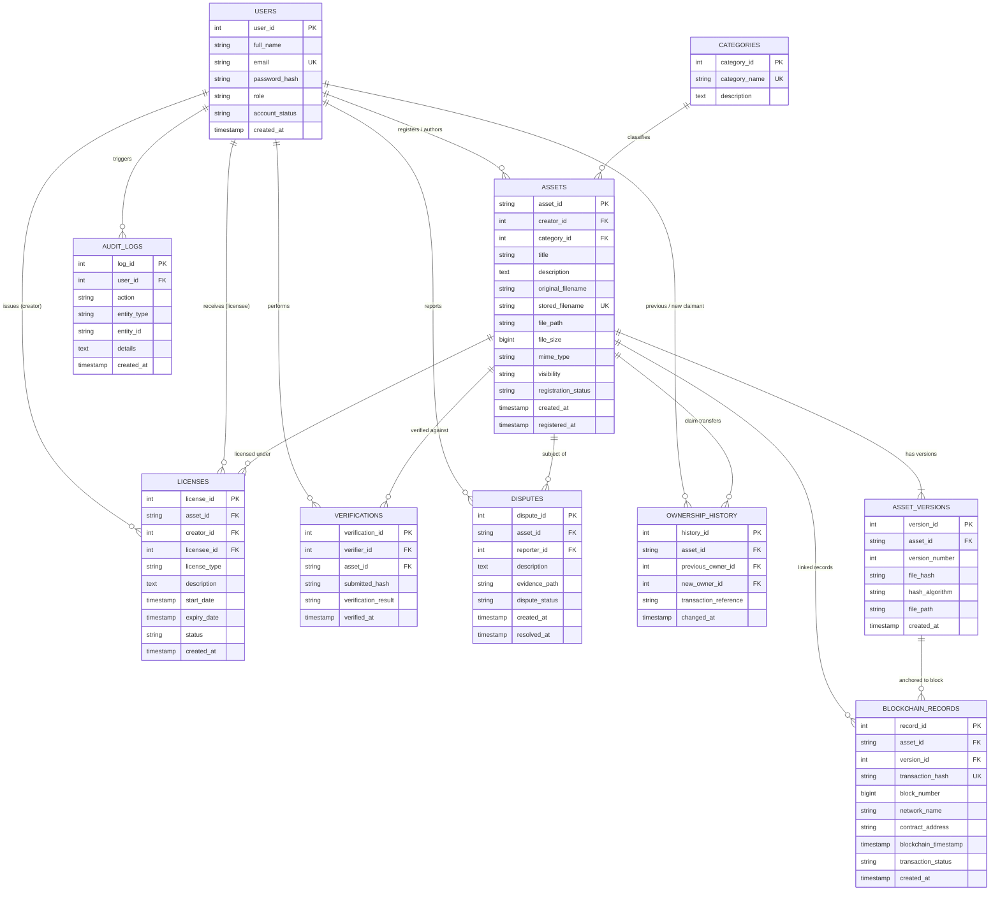

# ChainProof - Entity-Relationship (ER) Diagram & Architecture

ChainProof implements a normalized relational database design (3NF compliant) tailored for an academic DBMS project. The primary source of truth is PostgreSQL, storing user accounts, categories, asset metadata, cryptographic fingerprints, license agreements, verification logs, disputes, and audit trails.

---

## 1. Entity-Relationship Diagram

---

## 2. Cardinality & Relationship Breakdown

1. **USERS to ASSETS (1:N)**: A registered creator user can register zero, one, or multiple digital assets. Each asset is registered by exactly one creator.
2. **CATEGORIES to ASSETS (1:N)**: Each category classifies zero to many assets. Every asset must belong to exactly one category (`ON DELETE RESTRICT`).
3. **ASSETS to ASSET_VERSIONS (1:N)**: Every asset possesses at least one version (`version_number = 1`), with subsequent updates incrementing the version number. Historical versions are preserved.
4. **ASSET_VERSIONS to BLOCKCHAIN_RECORDS (1:1 / 1:N)**: Each confirmed version has a corresponding blockchain transaction record anchoring its cryptographic fingerprint.
5. **ASSETS to LICENSES (1:N)**: A creator can grant multiple licenses (commercial, personal, educational) to different licensee users for a registered asset.
6. **ASSETS to VERIFICATIONS (1:N)**: An asset may be verified zero or multiple times by verifiers submitting files or fingerprints.
7. **ASSETS to DISPUTES (1:N)**: Users can file disputes regarding authorship, unauthorized re-registration, or copyright infringements on an asset.
8. **ASSETS to OWNERSHIP_HISTORY (1:N)**: Any transfer of ownership claim is logged as an immutable history record, preserving complete audit trails.
9. **USERS to AUDIT_LOGS (1:N)**: Critical state transitions (logins, uploads, status changes, dispute reviews) are tracked against user accounts.
